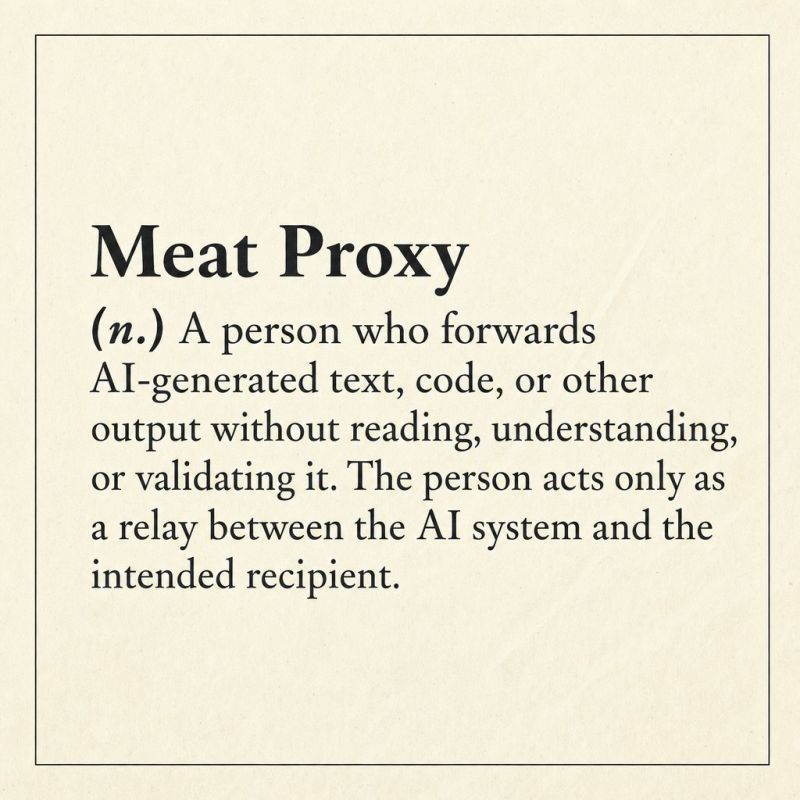
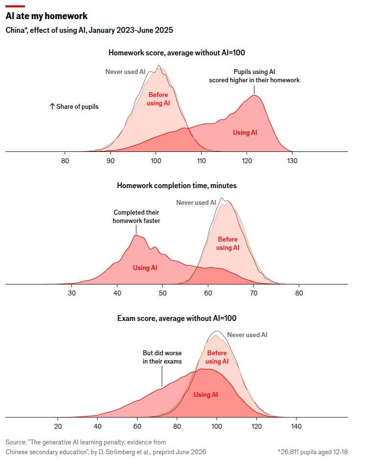

## I dag

1. **Fra tanke til kode.** Hvad vil det sige at give en maskine en instruks?
2. **AI som makker.** Kort om, hvad der sker med læringen, når maskinen skriver koden.
3. **Byggeklodserne i Python.** Notebooks, variable, typer, funktioner, metoder, biblioteker og logiske værdier.
4. **Øvelser.**

::: {.lille}
Vi samler også op på lektion 1 og eksamensopgaven undervejs.
:::

# Fra tanke til kode

Fra en idé i hovedet til noget, en maskine kan udføre.

## Hvorfor Python?

:::: {.to-kol}
::: {.kol}
- (Relativt) simpelt at lære.
- Koden er til at læse, også for andre end den, der skrev den.
- Stor brugerbase: der findes næsten altid et svar på jeres spørgsmål.
- [Biblioteker]{.ord ord="bibliotek"} til alle forskningsområder.
:::

::: {.kol}
**I kender allerede R.** Næsten alt, vi gør i dag, kan oversættes direkte.

Hver kodecelle har derfor to faner: **Python** og **R**. Vælger I R ét sted, skifter alle celler med.
:::
::::

## Dagens data: et borgerpanel {.kodelab}

500 opdigtede borgere. Cellen kører af sig selv, så tabellen `panel` findes resten af lektionen.

::::: {.panel-tabset}
### Python

:::: {.demo .stak}
```{pyodide}
import pandas as pd

url = "https://raw.githubusercontent.com/jeppeFQ/sds1/main/data/borgerpanel.csv"
panel = pd.read_csv(url)
panel.head()
```

::: {.forklaring}
1. {1} `import pandas as pd` henter biblioteket pandas, som kan arbejde med tabeller. `pd` er det korte kaldenavn.
2. {3} Adressen på filen gemmes som tekst under navnet `url`.
3. {4} `pd.read_csv(url)` læser filen og gemmer den som en tabel (en *DataFrame*) med navnet `panel`.
4. {5} `panel.head()` giver de første fem rækker. Det er cellens sidste linje, så resultatet vises.

Tallet yderst til venstre (0, 1, 2 ...) er rækkens nummer, også kaldet **indekset**. Python tæller fra 0.
:::
::::

### R

:::: {.demo .stak}
```{webr}
url <- "https://raw.githubusercontent.com/jeppeFQ/sds1/main/data/borgerpanel.csv"
panel <- read.csv(url)
head(panel, 5)
```

::: {.forklaring}
1. {1} Adressen på filen gemmes i `url`. `<-` betyder *gem*.
2. {2} `read.csv(url)` læser filen og gemmer den som en *data frame* med navnet `panel`.
3. {3} `head(panel, 5)` viser de første fem rækker. R tæller rækkerne fra 1.
:::
::::
:::::

::: {.lille}
Datasættet er syntetisk: tallene er trukket tilfældigt og siger intet om virkeligheden. Sådan er det lavet: `data/lav_borgerpanel.py`.
:::

## {.udsagn}

En computer gør **præcis** det, du skriver. Ikke det, du mener.

## Præcision er nøglen

> "Kan du hente en kop kaffe?"

Vi forstår det underforståede: *gå ud i køkkenet, tag en kop, hæld kaffe i, kom tilbage*. En maskine skal have hvert trin for sig:

::: {.incremental}
1. `kop = hent_kop_fra_koekken()`
2. `kaffe = haeld_kaffe(kop)`
3. `aflever_ved_skrivebord(kaffe)`
:::

::: {.aside}
Eksemplet er lånt fra Inga Strümke.
:::

## En tanke bliver til handling i fire niveauer

::::: {.trin-kort}
:::: {.kol}
1 · Tanke

"Jeg vil kende gennemsnits­indkomsten i panelet."
::::

:::: {.fragment}
2 · [Algoritme]{.ord}

"Læg alle tallene sammen, og del med antallet."
::::

:::: {.fragment}
3 · Kode

```python
panel["indkomst"].mean()
```
::::

:::: {.fragment}
4 · Maskinsprog

```
10110000 01100001
```
::::
:::::

::: {.fragment}
Vi skriver på niveau 3. Men arbejdet ligger i at komme fra 1 til 2: at gøre tanken præcis.
:::

## Niveau 2: algoritmen bag et gennemsnit

:::: {.to-kol .bred-smal}
::: {.figur figur="gennemsnit" vaerdier="15400,18500,66500,41200,21100" enhed="kr."}
:::

::: {.kol}
De fem første indkomster i panelet.

Som formel:

$$\bar{x} = \frac{x_1 + x_2 + \ldots + x_n}{n} = \frac{\sum_{i=1}^{n} x_i}{n}$$

To trin: **læg sammen**, **del med antallet**. Det er hele algoritmen.
:::
::::

## Niveau 3: den samme algoritme som kode {.kodelab}

::::: {.panel-tabset}
### Python

:::: {.proev forslag="Skriv `panel[\"indkomst\"].mean()` på en ny linje nederst. Får I det samme?"}
```{pyodide}
indkomst = panel["indkomst"]

total = indkomst.sum()
antal = len(indkomst)
gennemsnit = total / antal

print("Sum:", total)
print("Antal:", antal)
print("Gennemsnit:", gennemsnit)
```

::: {.forklaring}
1. {1} `panel["indkomst"]` vælger kolonnen `indkomst` fra tabellen. Vi giver den et kort navn.
2. {3} `.sum()` lægger alle tallene i kolonnen sammen: første trin i algoritmen.
3. {4} `len(...)` tæller, hvor mange værdier der er. Det er *n* i formlen.
4. {5} `/` dividerer: andet trin i algoritmen. Resultatet gemmes som `gennemsnit`.
5. {7-9} `print()` skriver en tekst og en værdi ud. Komma adskiller de ting, der skal vises.
:::
::::

### R

:::: {.proev forslag="Sammenlign med `mean(panel$indkomst)`."}
```{webr}
indkomst <- panel$indkomst

total <- sum(indkomst)
antal <- length(indkomst)
gennemsnit <- total / antal

cat("Sum:", total, "\n")
cat("Antal:", antal, "\n")
cat("Gennemsnit:", gennemsnit, "\n")
```

::: {.forklaring}
1. {1} `panel$indkomst` vælger kolonnen `indkomst`. I R henter `$` en kolonne ud af en tabel.
2. {3} `sum()` lægger tallene sammen.
3. {4} `length()` tæller, hvor mange værdier der er.
4. {5} `/` dividerer summen med antallet.
5. {7-9} `cat()` skriver tekst og tal ud efter hinanden. `"\n"` betyder *ny linje*.
:::
::::
:::::

## Niveau 4: maskinen forstår ikke Python

:::: {.to-kol}
::: {.kol}
- Processoren (CPU'en) forstår kun **maskinkode**: instrukser af 1-taller og 0'er.
- Python-[fortolkeren]{.ord ord="fortolker"} oversætter jeres kode til noget, maskinen kan udføre.
- Mellemformerne er *meget* mere besværlige at skrive end Python. Derfor skriver vi Python.
:::

::: {.kol}
Højt niveau: det, I skriver

```python
gennemsnit = total / antal
```

Mellemniveau: det, fortolkeren laver

```
LOAD total
LOAD antal
DIVIDE
STORE gennemsnit
```

Lavt niveau: det, processoren får

```
10110000 01100001
```
:::
::::

::: {.lille}
De to nederste bokse er en forenklet illustration, ikke rigtig maskinkode.
:::

## Præcise instrukser: hvem tjener over 20.000 kr.?

:::: {.to-kol}
::: {.kol}
Som [algoritme]{.ord}, trin for trin:

1. Tag det første tal i kolonnen.
2. Er det større end 20.000? Hvis ja: skriv det ud.
3. Tag det næste tal.
4. Gentag, indtil der ikke er flere tal.

Det er en [løkke]{.ord}. Tryk på knapperne og se forskellen på at spørge **én ad gangen** og at spørge **hele kolonnen**.
:::

::: {.figur figur="maske" vaerdier="15400,18500,66500,41200,21100,19400" graense="20000" navn="indkomst"}
:::
::::

## Algoritmen skrevet som en løkke {.kodelab}

::::: {.panel-tabset}
### Python

:::: {.proev forslag="Skift `20000` ud med `40000`. Hvor mange er tilbage?"}
```{pyodide}
for tal in panel["indkomst"].head(6):
    if tal > 20000:
        print("Over 20.000:", tal)
```

::: {.forklaring}
1. {1} `for tal in ...:` er en **løkke**. Den tager det første tal, kalder det `tal`, kører de indrykkede linjer, tager det næste tal, og så videre. `.head(6)` begrænser os til de seks første rækker (dem fra figuren).
2. {1} Kolonet `:` og **indrykningen** på næste linje er vigtige. Sådan ved Python, hvilke linjer der hører til løkken.
3. {2} `if tal > 20000:` stiller et ja/nej-spørgsmål. Kun hvis svaret er ja, køres linjen under.
4. {3} `print(...)` skriver teksten og tallet ud.

Senere i dag skriver vi det samme på én linje, uden løkke.
:::
::::

### R

:::: {.proev forslag="Skift `20000` ud med `40000`. Hvor mange er tilbage?"}
```{webr}
for (tal in head(panel$indkomst, 6)) {
  if (tal > 20000) {
    cat("Over 20.000:", tal, "\n")
  }
}
```

::: {.forklaring}
1. {1} `for (tal in ...)` er en løkke: den tager ét tal ad gangen og kalder det `tal`. `head(..., 6)` giver de seks første.
2. {1} Krøllede parenteser `{ }` viser, hvilke linjer der hører til løkken. (Python bruger indrykning.)
3. {2} `if (tal > 20000)` stiller et ja/nej-spørgsmål.
4. {3} `cat()` skriver teksten og tallet ud.
:::
::::
:::::

## {.udsagn}

Maskiner er dumme, men **utroligt hurtige og pålidelige**.

De kan gemme tal, sammenligne værdier, hoppe rundt i koden og gentage instrukser. Milliarder af gange i sekundet, uden fejl. Kodningens kunst er at bryde et menneskeligt problem ned til de simple trin og sætte dem sammen igen.

# AI som makker

Hvad sker der med læringen, når maskinen skriver koden?

## Er du en "meat proxy"?

{.nostretch fig-align="left" width="46%" fig-alt="Ordbogsopslag: Meat Proxy (n.), en person, der videresender AI-genereret tekst, kode eller andet output uden at læse, forstå eller validere det. Personen fungerer kun som stafet mellem AI-systemet og modtageren."}

## Bedre lektier, dårligere eksamen

{.nostretch fig-align="left" width="37%" fig-alt="Tre fordelingsfigurer for 26.811 kinesiske elever. Elever, der bruger AI, får højere karakterer for lektier og laver dem hurtigere, men klarer sig dårligere til eksamen end før de brugte AI."}

# UCloud

Her kører I jeres notebooks resten af kurset. Vi logger ind sammen.

# Byggeklodserne i Python

Syv begreber, I vil kunne genkende i al Python-kode.

## Notebooks og celler

En [notebook]{.ord} er et dokument, hvor tekst og kode står side om side. Koden står i [celler]{.ord ord="celle"}, som I kører én ad gangen.

::: {.incremental}
- **Rækkefølgen betyder noget.** Cellerne deler hukommelse. En variabel fra én celle kan bruges i de næste, men kun hvis cellen faktisk er blevet kørt.
- **Kun det sidste resultat vises**, medmindre I bruger `print()`.
- **Mellemrum omkring `+` er ligegyldige for maskinen**, men ikke for det menneske (jer selv), der skal læse koden i morgen.
- Alt efter `#` er en **kommentar**. Maskinen ignorerer den.
:::

## Gæt først: hvad viser cellen? {.kodelab}

::::: {.panel-tabset}
### Python

:::: {.proev gaet="Cellen har tre linjer. Hvad bliver vist?" valg="2, 4 og 6|6|En fejl" forslag="Sæt `print()` om hver linje, fx `print(1+1)`. Hvad ændrer sig?"}
```{pyodide}
1+1
2  +2
3+   3
```

::: {.forklaring}
1. {1-3} Tre regnestykker. Python regner dem alle ud, ét ad gangen, oppefra og ned.
2. {3} En celle viser kun resultatet af **den sidste linje**. De to første resultater bliver regnet ud og smidt væk.
3. {2-3} Mellemrummene er ligegyldige for maskinen: `2  +2` og `2 + 2` er det samme.
:::
::::

### R

:::: {.proev gaet="Cellen har tre linjer. Hvad bliver vist?" valg="2, 4 og 6|6|En fejl" forslag="I R vises alle tre resultater. Det er en af de små forskelle på de to sprog."}
```{webr}
1+1
2  +2
3+   3
```

::: {.forklaring}
1. {1-3} Tre regnestykker, som R regner ud ét ad gangen.
2. {1-3} R viser resultatet af **hver** linje. Python viser kun det sidste.
:::
::::
:::::

## `print()`: vis mig det her {.kodelab}

`print()` er den udtrykkelige besked til maskinen. I får brug for den, hver gang I vil se mere end ét resultat.

::::: {.panel-tabset}
### Python

:::: {.proev forslag="Skriv jeres eget navn i stedet for `World`."}
```{pyodide}
print(1+1)      # her vises resultatet
print(2  +2)    # også her
print(3+   3)   # og her
print("Hello World!")
```

::: {.forklaring}
1. {1-3} `print(...)` viser det, der står i parentesen. Nu ser vi alle tre resultater.
2. {1} Alt efter `#` er en kommentar til mennesker. Maskinen springer den over.
3. {4} Tekst skal stå i anførselstegn. Ellers tror Python, at `Hello` er navnet på en variabel.
:::
::::

### R

:::: {.proev forslag="Skriv jeres eget navn i stedet for `World`."}
```{webr}
print(1+1)      # her vises resultatet
print(2  +2)    # også her
print(3+   3)   # og her
print("Hello World!")
cat("Hello World!\n")   # cat() skriver teksten "råt"
```

::: {.forklaring}
1. {1-3} `print(...)` viser det, der står i parentesen.
2. {4} `print()` viser tekst med anførselstegn og `[1]` foran.
3. {5} `cat()` skriver kun selve teksten. `\n` betyder *ny linje*.
:::
::::
:::::

## Variable: et navn på en værdi

:::: {.to-kol}
::: {.kol}
En [variabel]{.ord} er et navn, I sætter på en værdi, så maskinen kan gemme den, og I kan hente den frem igen.

`indkomst = 28600` betyder: *gem værdien 28600, og kald pladsen i hukommelsen* `indkomst`.

Maskinen er ligeglad med, om navnet giver mening. Vi vælger **meningsfulde navne** for at kunne forstå vores egen kode.
:::

::: {.figur figur="variabel" navne="indkomst,by,panel" vaerdier="28600,'Aalborg',en hel tabel"}
:::
::::

::: {.lille}
I Python er (næsten) alt et [objekt]{.ord}: et tal, en tekst, et datasæt, en mappesti, et billede. Et objekt er både data og de ting, data kan gøre. Det kaldes objektorienteret programmering (OOP).
:::

## Variable husker fra linje til linje {.kodelab}

::::: {.panel-tabset}
### Python

:::: {.proev forslag="Sæt `indkomst = 40000` og kør igen. Alle tre resultater følger med."}
```{pyodide}
indkomst = 28600
skat = indkomst * 0.37
udbetalt = indkomst - skat

print(skat)
print(udbetalt)
```

::: {.forklaring}
1. {1} Gem værdien 28600 under navnet `indkomst`. Ét lighedstegn betyder *gem*, ikke *er lig med*.
2. {2} Hent værdien fra `indkomst`, gang med 0.37, og gem resultatet som `skat`. Python bruger punktum som decimaltegn.
3. {3} Træk `skat` fra `indkomst`, og gem resultatet som `udbetalt`.
4. {5-6} Vis de to resultater.

De 37 % er et regneeksempel, ikke de rigtige skatteregler.
:::
::::

### R

:::: {.proev forslag="Sæt `indkomst <- 40000` og kør igen."}
```{webr}
indkomst <- 28600
skat <- indkomst * 0.37
udbetalt <- indkomst - skat

print(skat)
print(udbetalt)
```

::: {.forklaring}
1. {1} Gem værdien 28600 under navnet `indkomst`. I R bruger vi `<-` til at gemme. `=` virker også, men `<-` er konventionen.
2. {2} Gang med 0.37, og gem resultatet som `skat`.
3. {3} Træk skatten fra, og gem som `udbetalt`.
4. {5-6} Vis de to resultater.
:::
::::
:::::

## Regn med variable {.kodelab}

::::: {.panel-tabset}
### Python

:::: {.proev forslag="Hvad giver `a % 2`? Og `b % 2`? Hvad kan man bruge det til?"}
```{pyodide}
a = 42
b = 56

print(a + b)      # addition
print(a - b)      # subtraktion
print(a * b)      # multiplikation
print(a / b)      # division
print(a ** 2)     # potens: a i anden
print(b // a)     # heltalsdivision
print(b % a)      # modulus: resten
```

::: {.forklaring}
1. {1-2} To variable, `a` og `b`.
2. {4-7} De fire regnearter. Division med `/` giver altid et kommatal.
3. {8} `**` betyder *opløftet i*. `a ** 2` er 42 · 42.
4. {9} `//` er heltalsdivision: 42 går én hel gang op i 56.
5. {10} `%` giver resten: 56 − 42 = 14.
:::
::::

### R

:::: {.proev forslag="Hvad giver `a %% 2`? Og `b %% 2`?"}
```{webr}
a <- 42
b <- 56

print(a + b)      # addition
print(a - b)      # subtraktion
print(a * b)      # multiplikation
print(a / b)      # division
print(a ^ 2)      # potens: a i anden
print(b %/% a)    # heltalsdivision
print(b %% a)     # modulus: resten
```

::: {.forklaring}
1. {1-2} To variable, `a` og `b`.
2. {4-7} De fire regnearter er ens i Python og R.
3. {8} Potens skrives `^` i R (Python: `**`).
4. {9-10} Heltalsdivision og modulus skrives `%/%` og `%%` i R (Python: `//` og `%`).
:::
::::
:::::

## Typer: hvad *er* værdien? {.kodelab}

[Typen]{.ord ord="type"} fortæller maskinen, hvad en værdi er, og hvad den kan gøre med den. De to vigtigste: **tal** (`int`, `float`) og **tekst** (`str`).

::::: {.panel-tabset}
### Python

:::: {.proev gaet="Hvad skriver Python ud?" valg="4|22|En fejl" forslag="Fjern anførselstegnene, og kør igen. Prøv også `\"Hej\" * 3`."}
```{pyodide}
print("2" + "2")
```

::: {.forklaring}
1. {1} Anførselstegnene gør `"2"` til **tekst**, ikke til et tal.
2. {1} For tekst betyder `+` *sæt sammen*. For tal betyder `+` *læg sammen*. Samme tegn, forskellig type, forskelligt resultat.
:::
::::

### R

:::: {.proev gaet="Hvad skriver R ud?" valg="4|22|En fejl" forslag="I R sætter man tekst sammen med `paste0(\"2\", \"2\")`."}
```{webr}
print("2" + "2")
```

::: {.forklaring}
1. {1} R nægter at lægge to tekster sammen med `+` og giver en fejl.
2. {1} Python sætter i stedet teksterne sammen. Begge sprog fortæller jer det samme: tekst er ikke tal.
:::
::::
:::::

## Spørg maskinen: `type()` {.kodelab}

Når koden ikke gør, som I forventer, er første skridt som regel at spørge, hvilken type I har med at gøre.

::::: {.panel-tabset}
### Python

:::: {.proev forslag="Hvilken type har `panel`? Og `panel[\"region\"]`?"}
```{pyodide}
a = 42
print(type(a))    # heltal

b = a / 2
print(b)
print(type(b))    # kommatal

c = "42"
print(type(c))    # tekst
c = int(c)        # tekst → tal
print(type(c))
```

::: {.forklaring}
1. {1-2} `type(a)` svarer `int`: et heltal (*integer*).
2. {4-6} Division giver altid et kommatal, en `float`. Derfor står der `21.0` og ikke `21`.
3. {8-9} `"42"` med anførselstegn er tekst, en `str` (*string*).
4. {10-11} `int(c)` laver teksten om til et tal. Nu kan vi regne med det.

Tal, der er blevet til tekst, er en klassisk fejlkilde, når vi indlæser data.
:::
::::

### R

:::: {.proev forslag="Hvilken klasse har `panel`? Og `panel$region`?"}
```{webr}
a <- 42L           # L fortæller R, at det skal være et heltal
print(class(a))

b <- a / 2
print(b)
print(class(b))    # kommatal

c <- "42"
print(class(c))    # tekst
c <- as.integer(c) # tekst → tal
print(class(c))
```

::: {.forklaring}
1. {1-2} I R spørger man med `class()`. `42L` er et heltal (`integer`).
2. {4-6} Division giver et kommatal (`numeric`).
3. {8-9} `"42"` med anførselstegn er tekst (`character`).
4. {10-11} `as.integer()` laver teksten om til et tal.
:::
::::
:::::

## Funktioner: genanvendelige opskrifter

:::: {.to-kol}
::: {.kol}
En [funktion]{.ord} tager noget ind ([argumenter]{.ord ord="argument"}), gør noget ved det og giver noget tilbage.

I har allerede brugt flere: `print()`, `len()`, `int()`, `type()`.

Python har en række **indbyggede** funktioner, og I kan **definere jeres egne** med `def`. Det svarer til at lære maskinen en ny instruks, som I regner med at skulle bruge igen.
:::

::: {.figur figur="funktion" navn="len" ind="en kolonne" ud="antal værdier"}
:::
::::

## Indbyggede funktioner {.kodelab}

::::: {.panel-tabset}
### Python

:::: {.proev forslag="Find den yngste med `min(alder)`."}
```{pyodide}
alder = panel["alder"]

print(len(alder))    # antal værdier
print(sum(alder))    # summen
print(max(alder))    # største værdi
print(round(sum(alder) / len(alder), 2))   # gennemsnit
```

::: {.forklaring}
1. {1} Kolonnen `alder` får et kort navn.
2. {3-5} `len()`, `sum()` og `max()` tager hele kolonnen ind og giver ét tal tilbage.
3. {6} Funktioner kan sættes ind i hinanden. Python regner indefra og ud: først `sum(alder) / len(alder)`, så `round(..., 2)`.
4. {6} `round()` tager **to** argumenter adskilt af komma: tallet og antallet af decimaler.
:::
::::

### R

:::: {.proev forslag="Find den yngste med `min(alder)`."}
```{webr}
alder <- panel$alder

print(length(alder))   # antal værdier
print(sum(alder))      # summen
print(max(alder))      # største værdi
print(round(mean(alder), 2))   # gennemsnit
```

::: {.forklaring}
1. {1} Kolonnen `alder` får et kort navn.
2. {3-5} `length()`, `sum()` og `max()` tager hele kolonnen ind og giver ét tal tilbage.
3. {6} `round(mean(alder), 2)`: først gennemsnittet, så afrunding til 2 decimaler.
:::
::::
:::::

## Jeres egne funktioner {.kodelab}

::::: {.panel-tabset}
### Python

:::: {.proev forslag="Tilføj linjen `print(efter_skat(panel[\"indkomst\"]).head())`. Funktionen virker også på en hel kolonne."}
```{pyodide}
def efter_skat(indkomst, sats=0.37):
    return indkomst * (1 - sats)

print(efter_skat(28600))              # standardsatsen
print(efter_skat(28600, sats=0.40))   # egen sats
```

::: {.forklaring}
1. {1} `def` definerer en ny funktion med navnet `efter_skat`. I parentesen står argumenterne. `sats=0.37` er en **standardværdi**: den bruges, hvis I ikke angiver andet.
2. {2} Den indrykkede linje er opskriften. `return` sender resultatet tilbage til den, der kaldte funktionen.
3. {4} Her kaldes funktionen med ét argument. `sats` er derfor 0.37.
4. {5} Her angiver vi selv satsen.

Der sker ingenting, når funktionen defineres. Først når den kaldes, bliver opskriften udført.
:::
::::

### R

:::: {.proev forslag="Tilføj linjen `print(head(efter_skat(panel$indkomst)))`. Funktionen virker også på en hel kolonne."}
```{webr}
efter_skat <- function(indkomst, sats = 0.37) {
  indkomst * (1 - sats)
}

print(efter_skat(28600))                # standardsatsen
print(efter_skat(28600, sats = 0.40))   # egen sats
```

::: {.forklaring}
1. {1} `function(...)` laver en funktion, og `<-` gemmer den under navnet `efter_skat`. `sats = 0.37` er en standardværdi.
2. {2} Opskriften. I R gives resultatet af den sidste linje automatisk tilbage.
3. {5} Kald med ét argument: `sats` er 0.37.
4. {6} Her angiver vi selv satsen.
:::
::::
:::::

## Metoder: funktioner, der hører til et objekt

En [metode]{.ord} kaldes med **punktum** efter objektet: `objekt.metode()`.

:::: {.to-kol}
::: {.kol}
**Funktion**

```python
len(tekst)
```

Funktionen får teksten ind som argument.
:::

::: {.kol}
**Metode**

```python
tekst.upper()
```

Teksten stiller selv metoden til rådighed.
:::
::::

Hvilke metoder I kan bruge, afhænger af objektets **type**. En tekst kan noget andet end en kolonne med tal.

## Metoder på tekst og på kolonner {.kodelab}

::::: {.panel-tabset}
### Python

:::: {.proev forslag="Prøv `panel[\"region\"].value_counts()`: hvor mange bor i hver region?"}
```{pyodide}
tekst = "  Social Data Science  "

print(tekst.strip())           # fjerner mellemrum i enderne
print(tekst.strip().upper())   # metoder kan kædes
print(tekst.count("a"))        # tæller "a"

print(panel["indkomst"].mean())   # kolonnens egne metoder
print(panel["indkomst"].max())
print(panel["region"].str.upper().head(3))
```

::: {.forklaring}
1. {3} `.strip()` fjerner mellemrum i begge ender af teksten.
2. {4} Metoder kan **kædes**: først `.strip()`, og på resultatet `.upper()`, som laver alt til store bogstaver.
3. {5} `.count("a")` tæller, hvor mange gange `a` forekommer.
4. {7-8} En kolonne med tal har andre metoder: `.mean()` er gennemsnittet, `.max()` den største værdi.
5. {9} `.str` giver adgang til tekstmetoderne for **hele kolonnen på én gang**. `.head(3)` viser de tre første.
:::
::::

### R

:::: {.proev forslag="Prøv `table(panel$region)`: hvor mange bor i hver region?"}
```{webr}
tekst <- "  Social Data Science  "

print(trimws(tekst))            # fjerner mellemrum i enderne
print(toupper(trimws(tekst)))   # funktioner pakkes ind i hinanden
print(lengths(regmatches(tekst, gregexpr("a", tekst))))   # tæller "a"

print(mean(panel$indkomst))
print(max(panel$indkomst))
print(head(toupper(panel$region), 3))
```

::: {.forklaring}
1. {3} `trimws()` fjerner mellemrum i begge ender.
2. {4} R har kun få metoder. Man skriver som regel `funktion(objekt)` og pakker funktionerne ind i hinanden.
3. {5} At tælle et bogstav kræver lidt mere i ren R: find alle forekomster, og tæl dem.
4. {7-9} `mean()`, `max()` og `toupper()` virker på hele kolonnen på én gang.
:::
::::
:::::

## Biblioteker: andres kode, klar til brug

Et [bibliotek]{.ord} er en samling færdige funktioner, som andre har skrevet og delt. Python kan ikke selv læse en CSV-fil. Det er `pandas`, der kan.

- `import pandas as pd` henter hele biblioteket og giver det kaldenavnet `pd`.
- `from statistics import median` henter kun én funktion.

Kaldenavnet `pd` er så udbredt, at næsten al Python-kode, I møder, bruger det.

::: {.lille}
Et bibliotek **installeres** én gang (`pip install pandas` / `install.packages("dplyr")`), men **indlæses**, hver gang I starter en ny session.
:::

## Et bibliotek i brug: histogram {.kodelab}

Træk i skyderen. Hvor mange søjler skal der til, før fordelingen bliver tydelig?

```{ojs}
//| echo: false
viewof bins = sds1.skyder({ label: "Antal søjler (bins)", min: 2, max: 60, value: 10 })
```

::::: {.panel-tabset}
### Python

:::: {.demo}
```{pyodide}
#| input:
#|   - bins
import matplotlib.pyplot as plt
from statistics import median

print("Median:", median(panel["indkomst"]))
panel["indkomst"].plot(kind="hist", bins=bins,
    color="#13756F", edgecolor="white", figsize=(6, 3.4))
plt.xlabel("Månedlig indkomst (kr.)")
plt.ylabel("Antal personer")
plt.tight_layout()
plt.show()
```

::: {.forklaring}
1. {1} `matplotlib` er biblioteket, der tegner figurer. `plt` er dets kaldenavn.
2. {2} Fra biblioteket `statistics` henter vi kun funktionen `median`.
3. {4} Medianen er den midterste værdi, når alle indkomster er stillet op efter størrelse.
4. {5-6} `.plot(kind="hist", bins=...)` tegner et histogram. `bins` er antallet af søjler, og her styres det af skyderen. Linje 6 er farver og størrelse.
5. {7-8} Tekst på akserne.
6. {9-10} `plt.tight_layout()` sørger for, at teksten ikke bliver skåret af. `plt.show()` viser figuren.
:::
::::

### R

:::: {.demo}
```{webr}
#| input:
#|   - bins
cat("Median:", median(panel$indkomst), "\n")
hist(panel$indkomst, breaks = bins, col = "#13756F", border = "white",
     main = "", xlab = "Månedlig indkomst (kr.)", ylab = "Antal personer")
```

::: {.forklaring}
1. {1} `median()` er indbygget i R.
2. {2-3} `hist()` tegner et histogram. `breaks` er antallet af søjler og styres af skyderen. R runder selv til "pæne" intervaller, så antallet passer ikke altid præcist.
:::
::::
:::::

## Logiske værdier: `True` og `False`

En [boolean]{.ord} kan kun være to ting: `True` eller `False`. Det er svaret, når I stiller maskinen et ja/nej-spørgsmål.

:::: {.to-kol}
::: {.kol}
**Ét lighedstegn gemmer**

```python
indkomst = 28600
```
:::

::: {.kol}
**To lighedstegn sammenligner**

```python
indkomst == 28600
```
:::
::::

At forveksle `=` og `==` er en af de allerhyppigste fejl. Booleans er fundamentet under al filtrering af data.

## Stil ja/nej-spørgsmål {.kodelab}

::::: {.panel-tabset}
### Python

:::: {.proev forslag="Skift `and` ud med `or` i linje 7. Hvorfor ændrer svaret sig ikke?"}
```{pyodide}
indkomst = 28600

print(indkomst > 20000)     # større end
print(indkomst == 28600)    # er lig med (to tegn!)
print(indkomst != 28600)    # er forskellig fra
print(indkomst >= 30000)    # større end eller lig med
print(indkomst > 20000 and indkomst < 30000)   # begge sande
print(indkomst < 20000 or indkomst == 28600)   # mindst én sand
```

::: {.forklaring}
1. {1} Ét lighedstegn: gem 28600 som `indkomst`.
2. {3-6} Fire sammenligninger. Hver giver `True` eller `False`.
3. {7} `and`: svaret er kun `True`, hvis **begge** dele er sande.
4. {8} `or`: svaret er `True`, hvis **mindst én** del er sand.
:::
::::

### R

:::: {.proev forslag="Skift `&` ud med `|` i linje 7. Hvorfor ændrer svaret sig ikke?"}
```{webr}
indkomst <- 28600

print(indkomst > 20000)     # større end
print(indkomst == 28600)    # er lig med (to tegn!)
print(indkomst != 28600)    # er forskellig fra
print(indkomst >= 30000)    # større end eller lig med
print(indkomst > 20000 & indkomst < 30000)    # begge sande
print(indkomst < 20000 | indkomst == 28600)   # mindst én sand
```

::: {.forklaring}
1. {3-6} Sammenligningerne skrives ens i R og Python. R svarer `TRUE` og `FALSE` med store bogstaver.
2. {7} `&` betyder *og* (Python: `and`).
3. {8} `|` betyder *eller* (Python: `or`).
:::
::::
:::::

## Fra løkke ... {auto-animate="true"}

Sådan spurgte vi tidligere: én række ad gangen.

```{.python data-id="filter"}
for tal in panel["indkomst"]:
    if tal > 20000:
        print(tal)
```

## ... til én linje {auto-animate="true"}

Nu spørger vi **hele kolonnen** på én gang. Det kaldes [vektoriseret]{.ord} kode, og det er sådan, vi arbejder med data i pandas.

```{.python data-id="filter"}
panel[panel["indkomst"] > 20000]
```

Spørgsmålet `panel["indkomst"] > 20000` giver én boolean pr. række. Tabellen beholder de rækker, hvor svaret er `True`.

## Booleans i praksis: filtrering {.kodelab}

```{ojs}
//| echo: false
viewof graense = sds1.skyder({ label: "Indkomst over", min: 10000, max: 100000, step: 5000, value: 20000, enhed: "kr." })
```

::::: {.panel-tabset}
### Python

:::: {.demo}
```{pyodide}
#| input:
#|   - graense
over = panel["indkomst"] > graense

print(over.head())             # én boolean pr. række
print("Antal True:", over.sum())
panel[over].head(4)            # kun rækkerne, hvor svaret er True
```

::: {.forklaring}
1. {1} Sammenligningen laves for **hele kolonnen** på én gang. `over` er en ny kolonne af `True` og `False`. `graense` er tallet fra skyderen.
2. {3} De fem første svar, ét pr. række.
3. {4} `True` tæller som 1 og `False` som 0. Summen er derfor antallet af personer over grænsen.
4. {5} `panel[over]` beholder kun de rækker, hvor `over` er `True`. `.head(4)` viser de fire første.
:::
::::

### R

:::: {.demo}
```{webr}
#| input:
#|   - graense
over <- panel$indkomst > graense

print(head(over, 5))              # én boolean pr. række
cat("Antal TRUE:", sum(over), "\n")
head(panel[over, ], 4)            # kun rækkerne, hvor svaret er TRUE
```

::: {.forklaring}
1. {1} Sammenligningen laves for hele kolonnen på én gang.
2. {3} De fem første svar.
3. {4} `TRUE` tæller som 1, så summen er antallet over grænsen.
4. {5} `panel[over, ]` beholder de rækker, hvor `over` er `TRUE`. Kommaet betyder: *alle kolonner*.
:::
::::
:::::

## Opsamling

- **Variable** gemmer værdier under et navn, vi selv vælger.
- **Typen** bestemmer, hvad en værdi er, og hvad man kan gøre med den.
- **Funktioner** tager noget ind og giver noget tilbage. Vi bruger andres eller skriver vores egne.
- **Metoder** er funktioner, der hører til et objekt: `objekt.metode()`.
- **Biblioteker** giver adgang til alt det, andre har lavet før os.
- **Booleans** er ja/nej-svar, og med dem filtrerer vi hele kolonner på én gang.

# Øvelser

Nu er det jeres tur. Koden bliver husket, hvis I åbner slides igen derhjemme.

## Øvelse 1: en metode på en kolonne {.opgave}

::: {.opgavetekst}
Find **medianen** af alderen i panelet.

1. Udfyld hullet `______` med den rigtige metode.
2. Tryk **Kør**. Cellen fortæller, om svaret er rigtigt.

[3 min]{.timer tid=180}
:::

:::: {.oevelse}
```{pyodide}
median_alder = panel["alder"].______()
median_alder
```

::: {.hint}
Gennemsnittet fandt vi med `.mean()`. Metoden for medianen hedder det samme som på engelsk.
:::

::: {.loesning}
```python
median_alder = panel["alder"].median()
median_alder
```
:::

```{pyodide}
#| check: true
rigtigt = panel["alder"].median()
try:
    ok = float(result) == float(rigtigt)
except Exception:
    ok = False
feedback = {"correct": ok, "message": "Rigtigt! Medianen er den midterste alder i panelet." if ok else "Ikke helt. Udfyld hullet med metoden for medianen, og kør igen."}
feedback
```
::::

## Øvelse 2: tæl med en boolean {.opgave}

::: {.opgavetekst}
Hvor mange i panelet bor i **Nordjylland**?

1. Udfyld hullet, så hver række bliver sammenlignet med teksten `"Nordjylland"`.
2. Hvorfor kan man bruge `.sum()` til at tælle?

[4 min]{.timer tid=240}
:::

:::: {.oevelse}
```{pyodide}
nordjyder = panel["region"] ______ "Nordjylland"
nordjyder.sum()
```

::: {.hint}
I skal **sammenligne**, ikke gemme. Det kræver to lighedstegn.
:::

::: {.loesning}
```python
nordjyder = panel["region"] == "Nordjylland"
nordjyder.sum()
```
:::

```{pyodide}
#| check: true
rigtigt = (panel["region"] == "Nordjylland").sum()
try:
    ok = int(result) == int(rigtigt)
except Exception:
    ok = False
feedback = {"correct": ok, "message": "Rigtigt! True tæller som 1, så summen er antallet af nordjyder." if ok else "Ikke helt. Brug == til at sammenligne, og kør igen."}
feedback
```
::::

## Sidst i dag {.sidst}

:::: {.kort-raekke}
::: {.kol}
**Det vigtigste**

En maskine gør præcis det, I skriver. Tænk i trin, og spørg hele kolonnen på én gang.
:::

::: {.kol}
**Øvelser**

[Notebook med dagens øvelser](materiale/SDS1_l2_notebook.ipynb) og [Gæt outputtet (PDF)](materiale/SDS1_l2_handout.pdf). Kør dem i UCloud.
:::

::: {.kol}
**Næste gang**

[Lektion 3: Data wrangling](../03-data-wrangling/index.html). Vi vælger, filtrerer og grupperer med pandas.
:::
::::

[Tilbage til lektionens side](index.html) · [Alle lektioner](../../kursus/plan.html)

[]{.aau-logo role="img" aria-label="Aalborg Universitet"}
