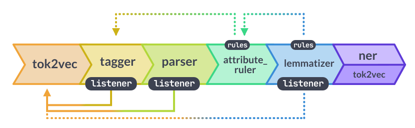

## I dag

1. **Fra scraper til tabel.** At hente struktur ud af rod.
2. **Preprocessing.** Syv operationer og deres konsekvenser.
3. **Datastrukturen.** Fra tekst til document-term matrix.
4. **spaCy.** Sprogmodeller i stedet for regler.
5. **Øvelser.**

::: {.lille}
Ingen R-kode i dag: værktøjerne har mig bekendt ikke et meningsfuldt alternativ i R, der kan køre i browseren. Alt kan dog også gøres i R lokalt.
:::

## Dagens data

I sidste uge hentede I data ned fra nettet. I dag arbejder vi med resultatet af sådan en scraping.

- **7.207 jobopslag** fra fire jobportaler, indsamlet i uge 41 til 49 i 2023: `job.aka.dk`, `jobbank.dk`, `Djof_Jobunivers` og `akademikerjob.dk`.
- Cirka **4,5 millioner ord**.
- Fire forskellige scrapere, fire forskellige måder at gøre det på.

> Målet i dag er ikke at analysere opslagene. Målet er at nå frem til en **datastruktur**, man *kan* analysere.

::: {.lille}
Næste gang analyserer vi med PCA og k-means.
:::

# Fra scraper til tabel

Rå scrapede data kan sjældent bare læses ind. Først skal rodet forstås.

## Første forsøg

```python
import pandas as pd
opslag = pd.read_csv("jobapplications_fall-2023.csv")
```

```
ParserError: Error tokenizing data.
C error: Expected 1 fields in line 3, saw 3
```

::: {.fragment}
Tre ting er galt med filen, og `read_csv` fortæller kun om én ad gangen.
:::

## Tre ting er galt

::::: {.trin-kort}
:::: {.kol}
1 · Separator

Dansk Excel bruger `;`, ikke `,`.
::::

:::: {.fragment}
2 · Overskrift

Første linje er `Column1;Column2;...`. Den rigtige overskrift står på linje to. (Og linje 7174 indeholder en fejl.)
::::

:::: {.fragment}
3 · Tegnsæt

Filen er ikke UTF-8. `København` står som `K?benhavn`.
::::
:::::

::: {.fragment}
```python
opslag = pd.read_csv("jobapplications_fall-2023.csv",
                     sep=";", encoding="mac_roman", skiprows=[1, 7174])
```
:::

## Tegnsæt: samme byte, tre bogstaver

En tekstfil er bytes. Tegnsættet er **aftalen** om, hvilket tegn hver byte betyder. Den samme byte, `0xBF`, læst med tre aftaler:

::::: {.trin-kort}
:::: {.kol}
Mac Roman

**ø**
::::

:::: {.kol}
Latin-1

**¿**
::::

:::: {.kol}
UTF-8

*ugyldig*
::::
:::::

Filen fortæller ikke selv, hvilken aftale der gælder. Man gætter, indtil teksten ser rigtig ud.

> Får I `ø` eller `?` i stedet for `ø`, er det næsten aldrig et problem med data. Det er et problem med, hvordan de bliver **læst**.

## Et udsnit af data {.kodelab}

Cirka 10 % af materialet, så det kan køre i browseren. Cellen kører af sig selv.

:::: {.demo}
```{pyodide}
import pandas as pd

url = "https://raw.githubusercontent.com/jeppeFQ/sds1/main/data/jobopslag_udsnit.csv"
opslag = pd.read_csv(url)

print(opslag.shape)
print(opslag["source"].value_counts())
```

::: {.forklaring}
**Hvad gør koden?** Den indlæser et udsnit af jobopslagene (cirka 1.000) og tæller, hvor mange der kommer fra hver jobportal. Cellen kører af sig selv.

1. {4} `opslag = pd.read_csv(url)` læser udsnittet. Det er allerede gemt som almindelig CSV, så standardindstillingerne virker.
2. {6} `opslag.shape` viser antal rækker og kolonner.
3. {7} `opslag["source"].value_counts()` tæller, hvor mange gange hver værdi står i kolonnen `source`, sorteret med den hyppigste først.
:::
::::

## Hvad er der i tabellen? {.kodelab}

:::: {.proev}
```{pyodide}
print(opslag.columns.tolist())
print()
print(opslag.isna().sum()) 
```

::: {.forklaring}
**Hvad gør koden?** Den viser kolonnernes navne og tæller manglende værdier i hver kolonne.

1. {1} `opslag.columns.tolist()` giver kolonnenavnene som en almindelig Python-liste.
2. {2} `print()` uden noget i giver en tom linje, så outputtet bliver lettere at læse.
3. {3} `opslag.isna()` laver en tabel af samme størrelse, hvor hver celle er `True`, hvis værdien mangler.
4. {3} `.sum()` lægger hver kolonne sammen. `True` tæller som 1, så tallet er antallet af manglende værdier.

**Tip:** Vil I se de manglende værdier per jobportal, skriv `opslag.isna().groupby(opslag["source"]).sum()`. Giv `groupby()` selve kolonnen, ikke navnet: efter `.isna()` er `source` også blevet til `True`/`False`.
:::
::::

::: {.fragment}
`company` mangler for langt de fleste opslag. Men ikke tilfældigt: den findes for **alle** opslag fra jobbank.dk og for **ingen** fra de tre andre.
:::

## Firmanavnet findes alligevel {.kodelab}

:::: {.proev}
```{pyodide}
# find den første række, hvor feltet ikke er tomt
raekke = opslag[opslag["various_meta1"].notna()].index[0]

print(opslag.loc[raekke, "various_meta1"])
```

::: {.forklaring}
**Hvad gør koden?** Den finder det første opslag, hvor feltet `various_meta1` er udfyldt, og viser feltets indhold.

1. {2} `opslag["various_meta1"].notna()` giver `True` for hver række, hvor feltet **ikke** er tomt.
2. `opslag[...]` beholder kun de rækker.
3. {2} `.index` giver rækkenumrene på dem, der er tilbage, og `[0]` tager det første. Det gemmes som `raekke`.
4. {4} `opslag.loc[raekke, "various_meta1"]` slår op med rækkenummer og kolonnenavn og giver én celle.

Oversat: *find den første række, hvor feltet ikke er tomt, og vis, hvad der står i det.*
:::
::::

::: {.fragment}
Det ligger i `various_meta1` sammen med sted og dato, adskilt af linjeskift. Feltet er ikke data. Det er **tekst, der indeholder data**.
:::

## Hent data ud af teksten {.kodelab}

:::: {.proev}
```{pyodide}
linjer = opslag.loc[raekke, "various_meta1"].split("\n")

for i, l in enumerate(linjer):
    print(i, "|", l)
```

::: {.forklaring}
**Hvad gør koden?** Den deler feltet op i linjer og viser hver linje med et nummer foran.

1. {1} `.loc[raekke, "various_meta1"]` henter den samme celle som før.
2. {1} `.split("\n")` er en almindelig tekst-metode. Den deler teksten ved hvert linjeskift (`\n`) og giver en liste med én tekst per linje.
3. {3} `for i, l in enumerate(linjer):` løber gennem listen. `enumerate` giver både nummeret (`i`) og selve teksten (`l`).
4. {4} `print(i, "|", l)` skriver nummer og tekst med en lodret streg imellem.
:::
::::

## For hele kolonnen {.kodelab}

`.str` gør det samme for alle rækker på én gang.

:::: {.proev}
```{pyodide}
har_meta = opslag["various_meta1"].notna()

dele = opslag.loc[har_meta, "various_meta1"].str.split("\n")

print(dele.str.len().value_counts())
```

::: {.forklaring}
**Hvad gør koden?** Den gør det samme for **alle** opslag på én gang og tæller, hvor mange linjer felterne har.

1. {1} `har_meta = opslag["various_meta1"].notna()` er `True` for rækker, hvor feltet er udfyldt.
2. {3} `opslag.loc[har_meta, "various_meta1"]` vælger de rækker og kun den kolonne.
3. {3} `.str.split("\n")` deler hver tekst ved linjeskift. `.str` betyder: brug tekst-metoden på hver celle i kolonnen. Resultatet er en kolonne, hvor hver celle er en liste.
4. {5} `dele.str.len()` tæller elementerne i hver liste, og `.value_counts()` tæller, hvor ofte hver længde forekommer.
:::
::::

::: {.lille}
De fleste felter har tre linjer: firma, sted, indrykningsdato. Men ikke alle. Nogle har to.
:::

## Til diskussion

Fire scrapere har lagt data i felterne på fire måder.

Er det bedst at **rette i data** (fx i Excel) eller at **skrive kode**, der kan håndtere alle fire varianter?

[5 min]{.timer tid=300}

# Preprocessing

Hvert valg om, hvad der tæller som "det samme ord", ændrer data.

## Hvorfor rydde op? {.kodelab}

Hvert unikt ord er en **dimension**: én kolonne i en tabel med ét dokument pr. række.

:::: {.proev}
```{pyodide}
tekster = opslag["job_description"].astype(str)

# ét ord per række. Indekset husker, hvilket opslag ordet kom fra
ord = tekster.str.split().explode()

print("Tokens i alt:", len(ord))
print("Unikke ord:  ", ord.nunique())
```

::: {.forklaring}
**Hvad gør koden?** Den deler alle opslagstekster op i ord og tæller tokens og typer.

1. {1} `opslag["job_description"].astype(str)` vælger teksterne og sikrer, at alt behandles som tekst.
2. {4} `.str.split()` deler hver tekst ved mellemrum til en liste af ord.
3. {4} `.explode()` giver hvert ord sin egen række. Indekset (rækkenummeret) følger med, så vi stadig ved, hvilket opslag ordet kom fra.
4. {6} `len(ord)` er antallet af **tokens** (alle forekomster). `ord.nunique()` er antallet af **typer** (unikke ord).

Eksempel: `"Vi søger en forsker"` i opslag 0 bliver til fire rækker, `Vi`, `søger`, `en`, `forsker`, alle med indeks 0.
:::
::::

## Tokens og typer

:::: {.to-kol}
::: {.kol}
**Tokens** er forekomster. Står `job` 400 gange, er det 400 tokens.

**Typer** er unikke ord. `job` er én type.

Nogle trin fjerner mange **tokens**, andre mange **typer**. Følg de to tal, mens sætningen renses.
:::

::: {.figur figur="rens" tekst="Vi søger 2 erfarne Socialrådgivere til vores team i Aarhus. Vi tilbyder et godt team, og vi søger dig, der vil Aarhus." stopord="vi,til,i,et,og,der,dig,vores,vil"}
:::
::::

## De syv operationer

Denny & Spirling (2017) opstiller syv, som næsten alle bruger. Ingen af dem er neutrale.

| | Operation | Hvad det koster |
|---|---|---|
| **P** | Fjern tegnsætning | Hashtags og forkortelser går tabt |
| **N** | Fjern tal | "§ 17" og "2024" kan være indhold |
| **L** | Små bogstaver | `Rose` (navn) og `rose` (blomst) smelter sammen |
| **S** | Stemming | `universitet` og `universel` kan ende samme sted |
| **W** | Fjern stopord | Der findes ingen facitliste |
| **3** | n-grams | `social rådgiver` er ikke `socialrådgiver` |
| **I** | Fjern sjældne ord | Det sjældne kan være det interessante |

## L: små bogstaver {.kodelab}

:::: {.proev}
```{pyodide}
ord = ord.str.lower()

print("Tokens: ", len(ord))
print("Typer:  ", ord.nunique())
```

::: {.forklaring}
**Hvad gør koden?** Den laver alle ord om til små bogstaver.

1. {1} `ord.str.lower()` giver en ny kolonne med små bogstaver, som gemmes under det gamle navn.
2. Antallet af tokens er det samme. Antallet af typer falder, fordi `Vi` og `vi` nu er det samme ord.
:::
::::

Ingen **tokens** forsvinder, men mange **typer** gør. `Vi` og `vi` var to forskellige ord.

## P: tegnsætning {.kodelab}

:::: {.proev}
```{pyodide}
import string
tegn = string.punctuation + "«»…–—"

ord = ord.str.strip(tegn)
ord = ord[ord != ""]            # nogle ord var kun tegnsætning

print("Tokens: ", len(ord))
print("Typer:  ", ord.nunique())
```

::: {.forklaring}
**Hvad gør koden?** Den fjerner tegnsætning i begyndelsen og slutningen af hvert ord.

1. {1} `import string` henter Pythons indbyggede modul `string`. Det skal ikke installeres.
2. {2} `string.punctuation` er en tekst med de almindelige tegn: `!"#$%&'()*+,-./:;<=>?@[\]^_{|}~`. Vi lægger nogle danske tegn til med `+`.
3. {4} `ord.str.strip(tegn)` fjerner alle de tegn fra **enderne** af hvert ord: `"forsker,"` bliver til `"forsker"`. En bindestreg midt i, som i `data-driven`, bliver stående.
4. {5} `ord[ord != ""]` fjerner ord, der var ren tegnsætning og nu er blevet tomme.
:::
::::

::: {.lille}
Det største enkeltproblem i hele kæden: `job.`, `job,` og `job` var tre ord. Bemærk, at `.strip()` kun fjerner i enderne.
:::

## N: tal {.kodelab}

:::: {.proev}
```{pyodide}
ord = ord[~ord.str.contains(r"\d")]     # \d betyder "et ciffer"

print("Tokens: ", len(ord))
print("Typer:  ", ord.nunique())
```

::: {.forklaring}
**Hvad gør koden?** Den fjerner alle ord, der indeholder mindst ét ciffer.

1. {1} `ord.str.contains(r"\d")` er `True` for hvert ord med et ciffer. `\d` er et **regulært udtryk** for *ét ciffer 0–9*. `r` foran anførselstegnet gør, at `\` bliver læst bogstaveligt.
2. `~` betyder **ikke** og vender `True`/`False` om.
3. `ord[...]` beholder kun ordene uden cifre: `"2026"` og `"python3"` forsvinder, `"Python"` bliver.

Vil I kun fjerne rene tal, brug `ord[~ord.str.fullmatch(r"\d+")]`.
:::
::::

::: {.lille}
I jobopslag er tal lønninger, frister, timetal og paragraffer. Støj eller indhold? Det afhænger af spørgsmålet.
:::

## W: stopord {.kodelab}

:::: {.proev}
```{pyodide}
stopord = set("""og i jeg det at en den til er som på de med han af for ikke
der var mig sig men et har om vi min havde ham hun nu over da fra du ud sin
dem os op man hans hvor eller hvad skal selv her alle vil blev kunne ind når
være dog jo dette dig deres end mit også under have dens hvis dine disse
hvem vores jer sådan andre nogle bliver blive kan""".split())

ord = ord[~ord.isin(stopord)]

print("Tokens: ", len(ord))
print("Typer:  ", ord.nunique())
```

::: {.forklaring}
**Hvad gør koden?** Den fjerner danske stopord.

1. `"""..."""` er en tekst, der må fylde flere linjer.
2. {5} `.split()` deler den ved mellemrum og linjeskift til en liste af ord.
3. `set(...)` gør listen til en **mængde**: hvert ord står der kun én gang, og det går meget hurtigt at slå op i den.
4. {7} `ord.isin(stopord)` er `True` for hvert ord, der står på listen. `~` vender det om, så vi beholder de ord, der **ikke** er stopord.
:::
::::

Nu sker det modsatte: **en tredjedel af alle tokens forsvinder**, men vokabularet falder kun med antallet af ord på listen.

## I: sjældne ord {.kodelab}

:::: {.proev}
```{pyodide}
# ét ord per dokument: drop gengangere inden for samme opslag
par = ord.rename("ord").reset_index().drop_duplicates()
dok_frekvens = par["ord"].value_counts()

hyppige = dok_frekvens[dok_frekvens >= 5].index
ord = ord[ord.isin(hyppige)]

print("Tokens: ", len(ord))
print("Typer:  ", ord.nunique())
```

::: {.forklaring}
**Hvad gør koden?** Den beholder kun ord, der står i mindst 5 forskellige opslag.

1. {2} `ord.rename("ord")` giver kolonnen et navn, `ord`.
2. {2} `.reset_index()` laver rækkenumrene om til en almindelig kolonne, `index`. Nu har vi en tabel med to kolonner: hvilket opslag og hvilket ord.
3. {2} `.drop_duplicates()` fjerner gentagelser: står et ord ti gange i samme opslag, tæller det kun én gang.
4. {3} `par["ord"].value_counts()` tæller, i hvor mange opslag hvert ord står. Det kaldes **dokumentfrekvens**.
5. {5} `dok_frekvens[dok_frekvens >= 5].index` giver selve ordene, der står i mindst 5 opslag. `.index` er nødvendig, fordi vi vil have ordene, ikke tallene.
6. {6} `ord[ord.isin(hyppige)]` beholder kun de ord.
:::
::::

Nu falder **vokabularet** dramatisk, mens næsten alle tokens bliver.

## Hvor sjældent er "sjældent"? {.kodelab}

```{ojs}
//| echo: false
viewof graense = sds1.skyder({ label: "Ordet skal stå i mindst", min: 1, max: 50, value: 5, enhed: "opslag", vent: 350 })
```

:::: {.demo}
```{pyodide}
#| input:
#|   - graense
import string
alle = (opslag["job_description"].astype(str).str.lower()
        .str.split().explode().str.strip(string.punctuation + "«»…–—"))
alle = alle[alle != ""]

dok_frekvens = alle.rename("ord").reset_index().drop_duplicates()["ord"].value_counts()
behold = dok_frekvens[dok_frekvens >= graense].index

print("Typer før:        ", dok_frekvens.size)
print("Typer, der bliver:", behold.size)
print("Tokens, der bliver:", round(alle.isin(behold).mean() * 100, 1), "%")
```

::: {.forklaring}
1. {2-4} Samme rensning som før, skrevet som én kæde: små bogstaver, del i ord, ét ord pr. række, fjern tegnsætning i enderne og tomme ord.
2. {6} Tæl, i hvor mange **opslag** hvert ord forekommer. `drop_duplicates()` sørger for, at et ord kun tæller én gang pr. opslag.
3. {7} Behold de ord, der står i mindst `graense` opslag. Tallet kommer fra skyderen.
4. {9-11} Hvor mange typer er der før og efter, og hvor stor en andel af alle tokens overlever?
:::
::::

## Hele kæden

::: {.figur figur="soejler" serier="Tokens,Typer" raekker="Råt .split()|4546976|174336;+ små bogstaver|4546976|157174;+ fjern tegnsætning|4529235|105610;+ fjern tal|4442368|97076;+ fjern stopord|2969611|96998;+ fjern sjældne (df < 5)|2827026|24876"}
:::

Det **fulde** materiale på 7.207 opslag. **86 % af vokabularet er væk, 62 % af tokens er tilbage.** Det er dimensionalitetsreduktion.

## To slags reduktion

:::: {.to-kol}
::: {.kol}
**Stopord**

Fjerner 1,5 millioner tokens og 78 typer. Teksten bliver kortere. Tabellen bliver ikke smallere.
:::

::: {.kol}
**Sjældne ord**

Fjerner 72.000 typer og kun 3 % af tokens. Tabellen bliver meget smallere. Teksten bliver næsten ikke kortere.
:::
::::

**43.082 ord optræder i præcis ét dokument.** De fylder en fjerdedel af tabellen og kan pr. definition ikke bruges til at sammenligne dokumenter.

## Kombinationen betyder noget

Syv operationer, der hver kan slås til eller fra, giver **2⁷ = 128** forskellige datasæt af det samme materiale. Fire af dem, prøvet på 2.000 opslag:

| L | P | N | S | Unikke ord |
|---|---|---|---|---:|
| til | til | til | til | 45.638 |
| til | fra | fra | fra | 71.241 |
| fra | fra | fra | fra | 78.544 |

Samme tekster. Vokabularet varierer med en faktor to.

## Konsekvenserne afhænger af metoden

:::: {.to-kol}
::: {.kol}
**Klassifikation**

Man kan måle sig frem: prøv kombinationerne, og vælg den med den bedste accuracy. *Der findes et facit.*
:::

::: {.kol}
**Klyngeanalyse og topic models**

Der findes *ikke* noget facit. Ingen kan endegyldigt sige, om fire klynger er rigtigere end fem.
:::
::::

Rådene om preprocessing kommer mest fra klassifikationslitteraturen og overføres ukritisk til det usuperviserede. Det er Denny & Spirlings hovedanke.

> Jeres valg kan ændre konklusionen, uden at nogen kan opdage det.

## Hvad gør man så?

- **Skriv alle valg ned.** De hører hjemme i metodeafsnittet, ikke i en kommentar i koden.
- **Prøv flere kombinationer.** Holder resultatet på tværs af dem, er det **robust**.
- **Gør det systematisk.** Denny & Spirlings `preText` kører kombinationerne og måler, hvor meget de flytter resultatet.

# Datastrukturen

Fra ét ord pr. række til én række pr. dokument.

## Fra tidy tekst til document-term matrix

:::: {.to-kol .smal-bred}
::: {.kol}
Efter tokenisering er teksten **tidy**: én række pr. ord i et dokument. Det er let at tælle, filtrere og koble med andre data.

Men mange modeller kræver, at hvert **dokument** er én observation. Derfor tæller vi op til en **document-term matrix (DTM)**.
:::

::: {.figur figur="dtm" dok="erfaring erfaring udvikling|team team|erfaring"}
:::
::::

::: {.lille}
Det er en pivotering fra langt til bredt format (lektion 3): rækker = dokumenter, kolonner = ord, værdier = antal. Ord bliver til variable.
:::

## Hvert dokument er et punkt

Én række pr. dokument. Én kolonne pr. ord. Hver celle er en optælling.

|  | ansøgning | erfaring | team | udvikling |
|---|---|---|---|---|
| Tekst 1 | 2 | 5 | 0 | 3 |
| Tekst 2 | 1 | 0 | 4 | 0 |
| Tekst 3 | 0 | 3 | 2 | 1 |

Hver række er et **punkt i et rum** med lige så mange dimensioner, som der er ord. Det er den struktur, PCA, k-means, regression, klassifikation og topic models skal bruge.

## Sparsity {.kodelab}

:::: {.proev}
```{pyodide}
# crosstab tæller, hvor mange gange hvert ord står i hvert dokument
dtm = pd.crosstab(ord.index, ord)

print("Matrix:  ", dtm.shape)
print("Ikke-nul:", (dtm != 0).to_numpy().sum())
print("Sparsity:", round((dtm == 0).to_numpy().mean() * 100, 2), "%")
```

::: {.forklaring}
**Hvad gør koden?** Den bygger en document-term matrix (DTM) og måler, hvor stor en del af den der er nuller.

1. {2} `pd.crosstab(ord.index, ord)` laver en krydstabel: én række per opslag (`ord.index`), én kolonne per ord, og i hver celle antallet af gange, ordet står i opslaget.
2. {4} `dtm.shape` viser (antal opslag, antal ord).
3. {5} `(dtm != 0)` giver `True` for hver celle, der ikke er 0. `.to_numpy()` laver tabellen om til et rent talgitter (et NumPy-array), og `.sum()` tæller alle `True` i hele gitteret.
4. {6} `(dtm == 0).to_numpy().mean()` er andelen af nuller. Gange 100 giver procent, og `round(..., 2)` afrunder.
:::
::::

Langt over 90 % af tabellen er nuller. Det er ikke en fejl. Sådan er sprog: intet dokument bruger mere end en brøkdel af vokabularet.

## Hvorfor sparsity er et problem

- **Afstande bliver meningsløse.** I et rum med 25.000 dimensioner er næsten alt lige langt fra alt.
- **For mange parametre** i forhold til antallet af observationer.
- **Hukommelse.** 7.207 × 24.804 er 179 millioner tal.

> Derfor har vi brug for **dimensionalitetsreduktion**. Det er næste lektion.

# Hvad kan man med tællinger?

Når teksten er blevet til tællinger, kan man begynde at spørge.

## Fire klassiske greb

::::: {.trin-kort}
:::: {.kol}
Frekvenslister

Hvad fylder mest, og fylder det mere end forventet?
::::

:::: {.kol}
Kollokation

Hvilke ord optræder sammen oftere, end tilfældet ville give?
::::

:::: {.kol}
Nøgleord

Hvilke ord er karakteristiske for ét delkorpus sammenlignet med et andet?
::::

:::: {.kol}
Konkordans

Gå tilbage til teksten, og se ordet i sin kontekst.
::::
:::::

::: {.lille}
Klassiske korpuslingvistiske greb (Hunston).
:::

## Frekvens er ikke nok {.kodelab}

:::: {.proev}
```{pyodide}
print(ord.value_counts().head(15))
```

::: {.forklaring}
**Hvad gør koden?** Den viser de 15 hyppigste ord efter al oprydningen. `value_counts()` tæller hvert ord, og `.head(15)` viser de første 15.
:::
::::

::: {.fragment}
De hyppigste ord er `and`, `the`, `of`, `to`, `in`. Korpusset er ikke kun på dansk.
:::

## Korpusset er tosproget {.kodelab}

:::: {.proev}
```{pyodide}
paa_engelsk = tekster.str.lower().str.count(r"\bthe\b") >= 10

print(paa_engelsk.sum(), "opslag af", len(tekster))
print(round(paa_engelsk.mean() * 100, 1), "%")
```

::: {.forklaring}
**Hvad gør koden?** Den finder opslag, der sandsynligvis er skrevet på engelsk.

1. {1} `tekster.str.lower()` laver teksterne om til små bogstaver.
2. {1} `.str.count(r"\bthe\b")` tæller, hvor mange gange ordet *the* står i hver tekst. `\b` betyder *ordgrænse*, så *the* inde i *theory* ikke tæller med.
3. {1} `>= 10` er `True` for tekster med mindst ti forekomster. Vi bruger det som et simpelt tegn på engelsk.
4. {3} `paa_engelsk.sum()` tæller dem, og `.mean() * 100` giver andelen i procent.
:::
::::

En dansk stopordsliste rører ikke engelske stopord. De bliver stående og dominerer optællingen.

> Hvad gør I? Sorterer dem fra, oversætter dem eller analyserer dem hver for sig?

## Tabellen er et valg

Når tekst bliver til tabeller, kan vi analysere den statistisk. Men tabellen er **ikke et neutralt aftryk** af teksten. Den er resultatet af valg om:

- tokenisering
- stopord
- sprog
- optælling

Før vi kan "anvende maskinlæring" på tekst, skal vi forstå den datastruktur, vi selv har skabt.

# spaCy

Fra regler, vi selv skriver, til en model, der har lært af eksempler.

## Regler eller sprogmodel

:::: {.to-kol}
::: {.kol}
**Regler** (indtil nu)

Fjern disse tegn. Fjern disse ord. Klip enderne af.
:::

::: {.kol}
**Sprogmodel** (spaCy)

Trænet på store mængder tekst. Afgør ud fra **konteksten**, hvad hvert ord er.
:::
::::

`spaCy` giver tokenisering, lemmatisering, ordklasser og navngivne entiteter, også for dansk.

::: {.lille}
spaCy kan ikke køre i browseren. Koden på de næste slides skal køres i UCloud eller lokalt og kan derfor ikke redigeres her.
:::

## Pipelinen

```python
import spacy
nlp = spacy.load("da_core_news_sm")

doc = nlp("Vi søger en erfaren socialrådgiver til vores team i Aarhus.")
```

- `spacy.load()` henter en **model**, ikke bare en funktion.
- Teksten løber gennem en række trin, som hver tilføjer et lag information.
- Resultatet er ikke en liste, men et objekt, hvor hvert ord kender sin grundform, ordklasse og rolle i sætningen.

{.nostretch fig-align="left" width="78%" fig-alt="spaCy-pipelinen: teksten deles i tokens, og derefter tilføjer en række komponenter (fx ordklasser, afhængigheder, lemmaer og navngivne entiteter) hver deres lag af information til Doc-objektet."}

## Modellen har lært af mennesker

spaCy er ikke én algoritme. Det er et bibliotek med **sprogmodeller**, der er trænet til forskellige sproglige opgaver.

Modellen `da_core_news_sm` er trænet på tusindvis af **manuelt annoterede sætninger**, hvor mennesker har markeret:

- hvilke ordklasser ordene tilhører,
- hvilken grundform ordene har,
- hvilke ord der hører sammen,
- hvilke personer, steder og organisationer der nævnes.

## Fra eksempler til gæt

> Vi søger en erfaren socialrådgiver i Aarhus.

| ord | ordklasse | lemma |
|------|------|------|
| søger | VERB | søge |
| erfaren | ADJ | erfaren |
| socialrådgiver | NOUN | socialrådgiver |
| Aarhus | PROPN | Aarhus |

Modellen ser millioner af sådanne eksempler og lærer sammenhænge mellem ordets form, de omkringliggende ord og placeringen i sætningen.

**Den følger ikke regler. Den generaliserer fra eksempler** og gætter på den annotation, der ligner træningsdata mest.

# Preprocessing med spaCy

Lemmaer, ordklasser og stopord fra en model i stedet for fra en liste.

## Lemmatisering i stedet for stemming

```python
for tok in doc:
    print(tok.text, tok.lemma_, tok.pos_, tok.is_stop)
```

:::: {.to-kol}
::: {.kol}
**Stemming**

Klipper enderne af efter en regel. `universitet` og `universel` kan ende samme sted.
:::

::: {.kol}
**Lemmatisering**

Slår grundformen op i en model. `søger`, `søgte` og `søgt` bliver alle til `søge`.
:::
::::

::: {.lille}
`tok.is_stop` er en færdig stopordsliste. Jeres egen var på 78 ord. Denne er lavet af folk, der arbejder med området.
:::

## Ordklasser som filter

```python
navneord = [tok.lemma_ for tok in doc
            if tok.pos_ == "NOUN"]
```

I stedet for at *fjerne* ord fra en liste kan I **beholde** bestemte ordklasser.

- I jobopslag ligger indholdet i **navneordene**: kompetencer, fag, steder, titler.
- **Udsagnsordene** er stort set de samme i alle opslag: *søger, tilbyder, forventer*.

Det er en anden slags dimensionalitetsreduktion end en stopordsliste, begrundet i sproget frem for i en liste, nogen har skrevet.

## Hele korpusset

```python
renset = []
for doc in nlp.pipe(tekster, batch_size=50):
    renset.append([tok.lemma_.lower() for tok in doc
                   if not tok.is_stop
                   and not tok.is_punct
                   and not tok.like_num
                   and tok.pos_ in ("NOUN", "PROPN", "ADJ")])

opslag["ord"] = renset               # én liste pr. opslag
lemmaer = opslag["ord"].explode()    # langt format: ét ord pr. række
```

::: {.forklaring}
1. {2} `nlp.pipe()` kører mange tekster igennem ad gangen. Det er langt hurtigere end en løkke med `nlp(t)`. `batch_size` er, hvor mange den tager ad gangen: jo flere, desto mere hukommelse.
2. {3} For hvert ord i opslaget gemmes grundformen (`lemma_`) med små bogstaver.
3. {4-6} Tre betingelser, der svarer til Denny & Spirlings W, P og N, bare afgjort af en model i stedet for en liste.
4. {7} Et filter på ordklasse: kun navneord, egennavne og tillægsord. Det dækker ingen af de syv operationer.
5. {9-10} Resultatet lægges tilbage i tabellen og foldes ud til ét ord pr. række.
:::

## Hvad koster det?

::::: {.trin-kort}
:::: {.kol}
Tid

Reglerne kørte på sekunder. spaCy over 7.207 opslag tager minutter.
::::

:::: {.kol}
Sprog

Modellen er trænet på dansk nyhedstekst. Jobopslag er ikke nyhedstekst.
::::

:::: {.kol}
Gennemsigtighed

I kan læse jeres stopordsliste. I kan ikke læse en model.
::::
:::::

Vi flytter arbejdet fra forskeren til modellen.

# Øvelser

Nu er det jeres tur.

## Øvelse 1: tokens og typer {.opgave}

::: {.opgavetekst}
Hvor mange **typer** (unikke ord) er der i sætningen, når store og små bogstaver tæller som det samme?

1. Udfyld de to huller.
2. Hvor mange tokens er der?

[3 min]{.timer tid=180}
:::

:::: {.oevelse}
```{pyodide}
s = pd.Series("Vi søger dig Vi tilbyder team og vi søger team".split())
s.str.______().______()
```

::: {.hint}
Først små bogstaver med `.str.lower()`. Derefter tæller `.nunique()` unikke værdier.
:::

::: {.loesning}
```python
s = pd.Series("Vi søger dig Vi tilbyder team og vi søger team".split())
s.str.lower().nunique()
```
:::

```{pyodide}
#| check: true
rigtigt = pd.Series("Vi søger dig Vi tilbyder team og vi søger team".split()).str.lower().nunique()
try:
    ok = int(result) == int(rigtigt)
except Exception:
    ok = False
feedback = {"correct": ok, "message": "Rigtigt! 10 tokens, men kun 6 typer." if ok else "Ikke helt. Lav små bogstaver først, og tæl så unikke ord."}
feedback
```
::::

## Øvelser i notebooken

I får den **rå** fil, ikke den rensede. Kør notebooken i UCloud.

**Dokumentation:** [spaCy 101](https://spacy.io/usage/spacy-101)

## Sidst i dag {.sidst}

:::: {.kort-raekke}
::: {.kol}
**Det vigtigste**

Preprocessing er ikke neutral. Skriv valgene ned, og prøv flere kombinationer.
:::

::: {.kol}
**Øvelser**

Se [lektionens side](index.html) for dagens notebook og data.
:::

::: {.kol}
**Næste gang**

[Lektion 7: Computationel tekstanalyse](../07-computationel-tekstanalyse/index.html). PCA og k-means på det, vi har bygget i dag.
:::
::::

[Tilbage til lektionens side](index.html) · [Alle lektioner](../../kursus/plan.html)

[]{.aau-logo role="img" aria-label="Aalborg Universitet"}
