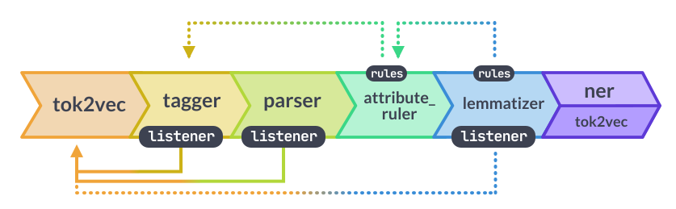

## I dag

1. **Tekst som data** og **korpus**: hvad er det, vi analyserer?
2. **Landskabet.** Hvad kan man med computationel tekstanalyse?
3. **Ordbogsmodeller** og en analyse af den politiske dagsorden.
4. **Sprogmodeller** og en analyse af tonen i Folketinget.
5. **Klyngemodeller.** PCA og k-means.
6. Øvelser og **portfolio**.

::: {.lille}
Ingen R-kode i dag: værktøjerne har mig bekendt ikke et meningsfuldt alternativ i R, der kan køre i browseren. Alt kan dog også gøres i R lokalt.
:::

## Dagens data

Referater af møderne i Folketinget fra oktober 2007 til november 2022.

- **1.711 møder**, hentet fra ft.dk i december 2022.
- Hvert møde er delt op i dagsordenspunkter. Hvert punkt har hele debatten som én tekst.
- Vi bruger **1. behandlingen af lovforslag**: **3.070 debatter** og cirka **22 millioner ord**.

## Korpusset {.kodelab}

Et tilfældigt udsnit på **900 debatter**, hver afkortet til de første 5.000 tegn. Cellen kører af sig selv.

:::: {.demo}
```{pyodide}
import pandas as pd
import numpy as np

url = "https://raw.githubusercontent.com/jeppeFQ/sds1/main/data/ft_udsnit.csv"
korpus = pd.read_csv(url)

print(korpus.shape)
print(korpus[["aar", "lovnr", "omraade"]].head())
```

::: {.forklaring}
**Hvad gør koden?** Den indlæser et udsnit af Folketingets debatter og viser tre kolonner for de første fem. Cellen kører af sig selv.

1. {1} `import pandas as pd` og `import numpy as np` henter to biblioteker og giver dem de korte navne `pd` og `np`. numpy bruges til regnestykker senere.
2. {4} `url = ...` er adressen på filen. `raw.githubusercontent.com` giver selve filen og ikke GitHubs webside om filen.
3. {5} `pd.read_csv(url)` læser CSV-filen direkte fra nettet ind i en tabel, som gemmes som `korpus`.
4. {7} `korpus.shape` viser (rækker, kolonner): 900 debatter.
5. {8} `korpus[["aar", "lovnr", "omraade"]]` vælger tre kolonner. De **dobbelte** klammer betyder, at vi giver en *liste* af kolonnenavne.
6. {8} `.head()` viser de første fem rækker.
:::
::::

# Tekst som data

Vi forstår en hilsen øjeblikkeligt. Computeren ser noget helt andet.

## Hvad computeren ser

:::: {.to-kol .smal-bred}
::: {.kol}
`"Hej med dig!"`

Vi forstår det med det samme: en hilsen, på dansk, venlig.

Computeren ser **tal**. Den forstår ingen betydning.
:::

::: {.figur figur="tegn" tekst="Hej med dig!"}
:::
::::

Alt i dag handler om at bygge bro fra tallene til betydningen, og om at se kritisk på, hvor meget der går tabt undervejs.

## Det kan I allerede: bag-of-words

:::: {.to-kol}
::: {.kol}
1. Små bogstaver
2. Fjern tegnsætning
3. Del op i ord
4. Tæl ordene i en dictionary
5. Find de hyppigste

Det er en **bag-of-words**-model: rækkefølgen smides væk, og tilbage står en optælling. Den er fundamentet under det meste i dag.
:::

::: {.figur figur="taeller" tekst="vi skal sænke skatten og vi skal hæve skatten"}
:::
::::

# Korpus

Det rå materiale er ikke et korpus. Det bliver det, fordi vi træffer valg.

## Fra referat til korpus

| Trin | Antal |
|---|---:|
| Møder i Folketinget | 1.711 |
| Dagsordenspunkter | 27.106 |
| ... heraf 1. behandling af lovforslag | 3.143 |
| ... uden punkter, der er udgået | **3.070** |

Hvert trin er en beslutning om, hvad der tæller som "en politisk debat".

## Hvad er "en tekst" her? {.kodelab}

Én tekst er **hele debatten** om et lovforslag: formanden, ordførerne, ministeren, spørgsmål og svar.

:::: {.proev}
```{pyodide}
print(korpus.loc[0, "tekst"][:600])
```

::: {.forklaring}
**Hvad gør koden?** Den viser starten af den første debat.

1. {1} `korpus.loc[0, "tekst"]` vælger rækken med indeks `0` og kolonnen `tekst`. Det er én celle, altså én hel debat.
2. {1} `[:600]` giver de første 600 tegn. En tekst kan skæres i stykker med `[start:slut]`, præcis som en liste.
:::
::::

Vi kan sammenligne **lovforslag**, men ikke partier eller politikere. Det er en **designbegrænsning**.

## Fire spørgsmål til ethvert korpus

1. **Hvor kommer teksterne fra?** Ét medie eller flere? Hvem har valgt netop dem?

2. **Hvem har skrevet dem?** Redigeret eller spontant? Én forfatter eller mange?

3. **Hvilke teksttyper er med og hvilke er evt. ikke?**

4. **Hvad skete der under indsamlingen?** Hvad blev der af formatering, billedtekster, kommentarer?

# Hvad kan man?

Fem metodefamilier, fra de mest gennemsigtige til de mest fleksible.

## Fem metodefamilier

1. **Ordbogsmodeller:** tæl foruddefinerede ord i kategorier.
2. **Semantisk analyse og netværk:** hvem gør hvad ved hvem, sprogligt og grammatisk.
3. **Sprogrepræsentationer:** tekst som tal (DTM, n-grams, word embeddings).
4. **Usuperviseret klyngedannelse:** find temaer, ingen har defineret på forhånd.
5. **Superviseret klassifikation:** udvid manuel kodning til millioner af tekster.

::: {.lille}
I dag rører vi ved 1, 3 og 4. Resten kommer i fokus på SDS2.
:::

## Validering

- **Korpusvalidering**: repræsenterer materialet det, I tror?

- **Metodisk validering**: måler modellen det, I tror?

::: {.incremental}

Når statistisk fit og fortolkelighed trækker i hver sin retning, skal der træffes et valg. Det valg hører i metodeafsnittet.

:::

# Ordbogsmodeller

En liste af ord, hver med en værdi. Slå op, og læg sammen.

## Hvad er en ordbogsmodel?

:::: {.to-kol}
::: {.kol}
- **LIWC:** 82 psykologiske kategorier.
- **AFINN:** cirka 3.500 danske ord med en score fra −5 til +5.
- **Jeres egen:** en liste, I selv definerer til ét bestemt spørgsmål.

Den mest **gennemsigtige** metodefamilie: I kan altid slå op, hvorfor en tekst fik sin score. Men også den mest **restriktive**: modellen ved kun det, listen siger.
:::

::: {.figur figur="ordbog" tekst="Det er en god beslutning for vores frihed" ordbog="god:2,godt:2,bedre:2,frihed:3,tryghed:2,krise:-2,vold:-3,frygt:-2"}
:::
::::

## Vi bygger én {.kodelab}

22 ord. Det er hele "modellen".

:::: {.demo}
```{pyodide}
ordbog = {
    "god": 2, "godt": 2, "bedre": 2, "bedst": 3, "stærk": 2,
    "sand": 2, "sandhed": 2, "frihed": 3, "tryghed": 2, "stolt": 2,
    "dårlig": -2, "værre": -2, "værst": -3, "katastrofe": -3,
    "løgn": -3, "svigt": -2, "trussel": -2, "farlig": -2,
    "krise": -2, "vold": -3, "frygt": -2, "svag": -2
}

print(len(ordbog), "ord")
```

::: {.forklaring}
**Hvad gør koden?** Den laver vores egen lille sentiment-ordbog: 22 ord med en positiv eller negativ værdi.

1. `ordbog = { ... }`: krøllede parenteser laver en **dictionary**.
2. {2} Hvert par skrives `nøgle: værdi`, fx `"god": 2`. Nøglen er ordet, værdien er scoren.
3. Parrene er adskilt af komma, og de må gerne fordeles over flere linjer.
4. {9} `len(ordbog)` tæller parrene: 22.
:::
::::

## Hvordan den scorer {.kodelab}

:::: {.proev}
```{pyodide}
# ét ord per række. Indekset husker, hvilken debat ordet kom fra
ord = (korpus["tekst"].astype(str)
       .str.lower()
       .str.replace(r"[^\wæøå ]", " ", regex=True)
       .str.split().explode())

print("tokens:", len(ord), "| typer:", ord.nunique())
```

::: {.forklaring}
**Hvad gør koden?** Den deler alle debatter op i ord: ét ord per række.

Læs det oppefra og ned:

1. {2} `korpus["tekst"]`: hent kolonnen `tekst`.
2. {2} `.astype(str)`: sørg for, at alt er tekst.
3. {3} `.str.lower()`: små bogstaver.
4. {4} `.str.replace(r"[^\wæøå ]", " ", regex=True)`: erstat alt, der **ikke** er bogstaver, tal eller mellemrum, med et mellemrum. `[^...]` betyder *alt undtagen*, og `\w` er bogstaver og tal.
5. {5} `.str.split()`: del teksten ved mellemrum.
6. {5} `.explode()`: én række per ord. Indekset husker, hvilken debat ordet kom fra.

Hele kæden står i en parentes, så den kan brydes over flere linjer.
:::
::::

## Kør den på korpusset {.kodelab}

:::: {.proev}
```{pyodide}
# slå hvert ord op i ordbogen og læg sammen per debat
korpus["score"] = ord.map(ordbog).groupby(level=0).sum()

print(korpus.groupby("omraade")["score"].mean().round(2).sort_values())
print()
print("Debatter med score præcis 0:", (korpus["score"] == 0).sum(), "af", len(korpus))
```

::: {.forklaring}
**Hvad gør koden?** Den slår hvert ord op i ordbogen og lægger scorerne sammen for hver debat.

1. {2} `ord.map(ordbog)` slår hvert ord op. Står ordet i ordbogen, får det sin værdi. Ellers bliver det `NaN` (manglende).
2. {2} `.groupby(level=0)` grupperer efter indekset, altså debatten. `level=0` betyder det første (og eneste) indeksniveau.
3. {2} `.sum()` lægger værdierne sammen per debat. `NaN` tæller ikke med.
4. `korpus["score"] = ...` gemmer resultatet som en ny kolonne. Det passer, fordi indekset er debatnummeret.
5. {4} `korpus.groupby("omraade")["score"].mean()` giver gennemsnittet per politikområde. `.round(2)` afrunder, og `.sort_values()` sorterer.
6. {6} `(korpus["score"] == 0).sum()` tæller debatter med score præcis 0. `True` tæller som 1.
:::
::::

::: {.lille}
`.map(ordbog)` slår hvert ord op. Findes ordet ikke, bliver det `NaN`, og `NaN` tæller ikke med, når vi lægger sammen.
:::

## Hvad fylder i scoren? {.kodelab}

:::: {.proev}
```{pyodide}
print(ord[ord.isin(ordbog.keys())].value_counts().head(8))
```

::: {.forklaring}
**Hvad gør koden?** Den viser, hvilke ordbogs-ord der optræder oftest.

Læs det indefra og ud:

1. {1} `ordbog.keys()` giver nøglerne i ordbogen, altså de 22 ord.
2. `ord.isin(...)` er `True` for hvert token, der står i ordbogen.
3. `ord[...]` beholder kun de tokens.
4. {1} `.value_counts()` tæller hvert ord, med det hyppigste først, og `.head(8)` viser de otte første.
:::
::::

::: {.fragment}
Det hyppigste ord er **`godt`**: 1.381 gange. Men i Folketinget er `godt` et høflighedsord: *"det er godt, at ministeren ..."*, *"godt, så går vi videre"*.
:::

## Negation

Hvad sker der med ordet `ikke`? Gæt, før I trykker.

:::::: {.to-kol }
::: {.kol}
::: {.figur figur="ordbog" tekst="Det er ikke en god beslutning" ordbog="god:2,godt:2,bedre:2,frihed:3,tryghed:2,krise:-2,vold:-3,frygt:-2"}
:::

En ordbogsmodel lægger tal sammen. **Den læser ikke.**
:::

::::::: {.kol}
:::: {.proev}
```{pyodide}
test = pd.Series(["Det er en god beslutning",
                     "Det er ikke en god beslutning",
                     "Ingen tryghed og ingen frihed"])

scorer = (test.str.lower().str.split().explode()
          .map(ordbog).groupby(level=0).sum())

print(pd.DataFrame({"tekst": test, "score": scorer}))
```

::: {.forklaring}
**Hvad gør koden?** Den tester ordbogen på tre sætninger, vi selv har skrevet.

1. `pd.Series([...])` laver en kolonne med tre sætninger. Indekset 0, 1, 2 er sætningens nummer.
2. {5} `.str.lower().str.split().explode()` er samme opskrift som på korpusset: små bogstaver, del i ord, ét ord per række.
3. {6} `.map(ordbog).groupby(level=0).sum()` slår op og lægger sammen per sætning.
4. {8} `pd.DataFrame({"tekst": test, "score": scorer})` sætter tekst og score side om side. Rækkerne passer sammen, fordi de har samme indeks.

Læg mærke til, at *ikke en god beslutning* får den samme positive score som *en god beslutning*.
:::
::::
:::::::
::::::

## AFINN

Den samme idé, professionelt lavet. `afinn` er et Python-bibliotek med en dansk ordliste på cirka 3.500 ord, udviklet af Finn Årup Nielsen.

```python
from afinn import Afinn

afinn = Afinn(language="da")

korpus["afinn"] = korpus["tekst"].map(afinn.score)
```

::: {.forklaring}
**Hvad gør koden?** Den bruger den færdige danske ordliste AFINN i stedet for vores egen. Kør den i UCloud eller lokalt (`pip install afinn`).

1. `from afinn import Afinn` henter `Afinn` fra pakken `afinn`.
2. `Afinn(language="da")` laver et objekt med den danske ordliste og gemmer det som `afinn`.
3. `korpus["tekst"].map(afinn.score)` kører `.score()` på hver tekst og gemmer resultatet i en ny kolonne.
4. `afinn.score` står **uden** parenteser. Vi giver selve funktionen til `.map()`, som så kalder den én gang for hver tekst.
:::

`.score()` gør præcis det samme som vores egen funktion. Den slår hvert ord op og lægger værdierne for ordene sammen.

::: {.lille}
Kan ikke installeres i browseren. Kør den i UCloud eller lokalt.
:::

## Hvad måler vi egentlig?

Hvis Retsvæsen scorer lavere end Beskæftigelse, hvad har vi så vist?

::: {.incremental}
- At debatterne handler om noget negativt, som vold og straf?
- At ordførerne er mere kritiske?
- At ordlisten passer bedre til det ene områdes ordforråd end det andets?
- Eller at man siger `godt` sjældnere, når man taler om kriminalitet?
:::

# Analyse: "Kriser" i Folketingssalen

> Fyldte italesættelsen af "kriser" mere i Folketingets lovgivningsdebatter under **finanskrisen** og **coronakrisen**?

Vi bruger her en ordbog til det, den er god til: at måle **et tema** snarere end en stemning.

## Ordbogen {.kodelab}

:::: {.proev}
```{pyodide}
kriseord = ["krise", "krisen", "kriser", "kriserne",
            "finanskrise", "finanskrisen", "coronakrise", "coronakrisen",
            "pandemi", "pandemien", "epidemi", "epidemien",
            "nedlukning", "nedlukningen",
            "hjælpepakke", "hjælpepakken", "hjælpepakker", "hjælpepakkerne"]

print(len(kriseord), "ord")
```

::: {.forklaring}
**Hvad gør koden?** Den laver en ordbog over kriseord. Denne gang er det en **liste**, ikke en dictionary, fordi ordene ikke har en værdi. Vi tæller bare, om de er der.

1. Listen skrives med firkantede parenteser og komma imellem.
2. Hvert ord står i alle sine bøjningsformer (*krise*, *krisen*, *kriser*), fordi vi ikke har lavet ordene om til grundform.
3. {7} `len(kriseord)` tæller ordene.
:::
::::

## Mål: per 1.000 ord {.kodelab}

Hvorfor pr. 1.000 ord og ikke bare antal? Fordi der ikke er lige mange debatter hvert år, og de er ikke lige lange.

:::: {.proev}
```{pyodide}
# ét ord per række, med året ved siden af
lang = ord.rename("ord").to_frame().join(korpus[["aar"]])
lang["krise"] = lang["ord"].isin(kriseord)

pr_aar = pd.DataFrame({
    "debatter": korpus.groupby("aar").size(),
    "pr_1000_ord": (lang.groupby("aar")["krise"].mean() * 1000).round(2),
})

print(pr_aar)
```

::: {.forklaring}
**Hvad gør koden?** Den beregner, hvor mange af hvert års ord der er kriseord, per 1.000 ord.

1. {2} `ord.rename("ord").to_frame()` laver ord-kolonnen om til en tabel med én kolonne, `ord`.
2. {2} `.join(korpus[["aar"]])` sætter debattens år på hvert ord. Det virker, fordi indekset i `ord` stadig er debatnummeret.
3. {3} `lang["krise"] = lang["ord"].isin(kriseord)` er `True` for hvert kriseord.
4. {7} `lang.groupby("aar")["krise"].mean()`: gennemsnittet af `True`/`False` er en **andel**. Gange 1.000 giver forekomster per 1.000 ord.
5. {6} `korpus.groupby("aar").size()` tæller debatter per år.
6. `pd.DataFrame({...})` samler de to kolonner i én tabel med årene som rækker.
:::
::::

## Tilbage til teksten {.kodelab}

Et tal fra en ordbog er ikke et resultat, før vi har set, hvilken kontekst ordene står i.

:::: {.proev}
```{pyodide}
eksempler = (korpus["tekst"]
             .str.findall(r"(?i).{0,60}\b\w*krise\w*.{0,60}")
             .explode()
             .dropna())

for linje in eksempler.sample(8, random_state=1):
    print("...", linje, "...")
```

::: {.forklaring}
**Hvad gør koden?** Den finder kriseordene i deres sammenhæng, så vi kan læse, hvad de handler om.

1. `.str.findall(...)` finder **alle** steder i hver debat, hvor mønsteret passer, og giver en liste per debat.
2. Mønsteret er et regulært udtryk:
    - `(?i)`: ligegyldigt om det er store eller små bogstaver.
    - `.{0,60}`: op til 60 vilkårlige tegn før og efter.
    - `\b\w*krise\w*`: et ord, der indeholder *krise*, fx *krisen* eller *finanskrisen*.
3. {3} `.explode()` giver ét fund per række, og `.dropna()` fjerner debatter uden fund.
4. {6} `.sample(8, random_state=1)` trækker otte tilfældige fund. `random_state=1` gør, at vi alle får de samme otte.
5. `for linje in ...: print("...", linje, "...")` skriver hvert fund ud.
:::
::::

::: {.lille}
Handler det om en akut krise? Eller om *boligkrisen*, *tillidskrisen*, *en krise i folkeskolen*?
:::

## Rammer data forudsigelsen? {.kodelab}

:::: {.proev}
```{pyodide}
from plotnine import (ggplot, aes, annotate, geom_line, geom_point,
                      scale_y_continuous, labs, theme_minimal)

data = pr_aar.reset_index()

figur = (ggplot(data, aes(x="aar", y="pr_1000_ord"))
         # forudsigelsen: de år, hvor vi forventer en top
         + annotate("rect", xmin=2007.5, xmax=2010.5,
                    ymin=-float("inf"), ymax=float("inf"), alpha=0.2)
         + annotate("rect", xmin=2019.5, xmax=2021.5,
                    ymin=-float("inf"), ymax=float("inf"), alpha=0.2)
         # data
         + geom_line()
         + geom_point(aes(size="debatter"))
         + scale_y_continuous(limits=(0, None))
         + labs(x="År", y="Kriseord per 1.000 ord", size="Debatter",
                title="Kriseord i 1. behandling af lovforslag")
         + theme_minimal())

figur.show()
```

::: {.forklaring}
**Hvad gør koden?** Den tegner kriseordene år for år med de forventede kriseår markeret som grå bånd.

1. `from plotnine import (...)` henter kun de funktioner, vi skal bruge.
2. {4} `pr_aar.reset_index()` laver årene fra indekset om til en almindelig kolonne, `aar`, som `aes()` kan bruge.
3. {9} `annotate("rect", xmin=..., xmax=..., ymin=-float("inf"), ymax=float("inf"), alpha=0.2)` tegner et gråt bånd. `-float("inf")` og `float("inf")` betyder *fra bunden til toppen* af figuren.
4. {13} `geom_line()` tegner linjen. `geom_point(aes(size="debatter"))` gør punkterne større, jo flere debatter året bygger på.
5. {15} `scale_y_continuous(limits=(0, None))` lader y-aksen starte i 0. `None` betyder *find selv toppen*.
6. {6} Figuren gemmes som `figur` og vises med `figur.show()`.
:::
::::

::: {.lille}
Det grå er det, vi forventede. Den sorte linje er det, vi fandt. Små punkter bygger på få debatter.
:::

## Hvad har vi vist, og hvad har vi ikke?

- **Vist:** hvor meget kriseordene fylder i 1. behandlingen af lovforslag, år for år.
- **Ikke vist:** hvor alvorlige kriserne var, eller hvad partierne mente. Ordbogen tæller. Den læser ikke.
- **Korpusset bestemmer svaret.** En krise, der blev håndteret uden for salen, er næsten usynlig her.
- **Ordbogen bestemmer svaret.** Tag `klimakrise` med, og kurven ændrer sig.

> Ordbogsmodellen er stærkest, når spørgsmålet er smalt.

# Analyse: den politiske dagsorden 2007-2022


## Spørgsmålet

> Hvor meget fylder klima, udlændinge og økonomi i Folketingets debatter, og har det ændret sig over tid?

- Tre korte **temaordbøger**, som vi selv definerer.
- Vi måler forekomster af hvert tema **pr. 1.000 ord**.

## Tre temaordbøger {.kodelab}

:::: {.proev}
```{pyodide}
temaer = {
    "klima": ["klima", "klimaet", "co2", "drivhusgasser", "vedvarende",
              "omstilling", "grøn", "grønne", "udledning", "klimaneutral"],
    "udlændinge": ["udlændinge", "flygtninge", "asyl", "asylansøgere",
                   "indvandrere", "integration", "opholdstilladelse", "udvisning"],
    "økonomi": ["økonomi", "økonomien", "vækst", "budget", "underskud",
                "besparelser", "finansiering", "konkurrenceevne"],
}

# ord til tema som én Series
ord_til_tema = pd.Series(temaer).explode()
ord_til_tema = pd.Series(ord_til_tema.index, index=ord_til_tema.values)

lang = ord.rename("ord").to_frame().join(korpus[["aar", "omraade"]])
lang["tema"] = lang["ord"].map(ord_til_tema)   # NaN hvis ordet ikke er i et tema

print(lang.head())
```

::: {.forklaring}
**Hvad gør koden?** Den laver tre temaordbøger og slår hvert ord op, så vi ved, hvilket tema det hører til.

1. `temaer = {...}` er en dictionary, hvor hver nøgle er et tema og hver værdi en liste af ord.
2. {11} `pd.Series(temaer).explode()` giver én række per ord med temaet som indeks.
3. {12} `pd.Series(ord_til_tema.index, index=ord_til_tema.values)` vender det om: nu er **ordet** indekset og **temaet** værdien. Så kan `.map()` slå hvert ord op.
4. {14} `ord.rename("ord").to_frame().join(korpus[["aar", "omraade"]])` laver en tabel med ord, år og område.
5. {15} `lang["ord"].map(ord_til_tema)` giver hvert ord dets tema, eller `NaN`, hvis ordet ikke er i nogen af ordbøgerne.
:::
::::

## Validering først: måler ordbøgerne det, vi tror? {.kodelab}

:::: {.proev}
```{pyodide}
pr_omraade = (
    lang.groupby(["omraade", "tema"]).size()
      .unstack(fill_value=0)
      .div(lang.groupby("omraade").size(), axis=0)
      .reindex(columns=list(temaer), fill_value=0)
    * 1000
)

print(pr_omraade.round(2))
```

::: {.forklaring}
**Hvad gør koden?** Den tjekker, om ordbøgerne rammer de politikområder, de burde.

1. {2} `lang.groupby(["omraade", "tema"]).size()` tæller, hvor mange ord fra hvert tema der står i hvert område. Ord uden tema (`NaN`) tælles ikke med.
2. {3} `.unstack(fill_value=0)` gør temaerne til kolonner. Kombinationer uden ord får 0.
3. {4} `.div(lang.groupby("omraade").size(), axis=0)` dividerer hver række med det samlede antal ord i området. `axis=0` betyder: brug én divisor per række.
4. {5} `.reindex(columns=list(temaer), fill_value=0)` sikrer, at alle tre temaer er med, i samme rækkefølge som i ordbogen.
5. {6} `* 1000` giver forekomster per 1.000 ord, og `.round(2)` afrunder.
:::
::::

::: {.lille}
**Klima** rammer 2,48 pr. 1.000 ord i Miljø og klima og 0,03 i Beskæftigelse. **Udlændinge** rammer 7,40 i Udlændinge. **Økonomi** er spredt over alle områder. Det er en test af *konstruktvaliditet*: ministeriet er en uafhængig variabel, som ordbogen burde hænge sammen med.
:::

## Og dækningen {.kodelab}

:::: {.proev}
```{pyodide}
ramt = (
    lang["tema"].notna()
    .groupby(level=0)
    .any()
)

print("Debatter der ikke rammer nogen af de tre:",
      (~ramt).sum(), "af", len(ramt))
```

::: {.forklaring}
**Hvad gør koden?** Den tæller, hvor mange debatter der slet ikke indeholder et temaord.

1. {2} `lang["tema"].notna()` er `True` for hvert ord, der hører til et tema.
2. {3} `.groupby(level=0)` grupperer efter debatten.
3. {4} `.any()` er `True`, hvis **mindst ét** ord i debatten hører til et tema.
4. {8} `~ramt` vender det om, så vi får debatterne **uden** træf, og `.sum()` tæller dem.
:::
::::

::: {.lille}
Over halvdelen af debatterne nævner ingen af ordene. Det er ikke en fejl. De handler bare om noget fjerde.
:::

## Over tid {.kodelab}

:::: {.proev}
```{pyodide}
pr_aar = (
    lang.groupby(["aar", "tema"]).size()
      .unstack(fill_value=0)
      .div(lang.groupby("aar").size(), axis=0)
      .reindex(columns=list(temaer), fill_value=0)
    * 1000
)

print(pr_aar.round(2))
```

::: {.forklaring}
**Hvad gør koden?** Den samme beregning som på valideringsslidet, nu med **år** i stedet for område.

1. `lang.groupby(["aar", "tema"]).size().unstack(fill_value=0)` tæller temaord per år og tema.
2. {4} `.div(lang.groupby("aar").size(), axis=0)` dividerer med det samlede antal ord i året.
3. {6} `.reindex(...)` og `* 1000` som før.
:::
::::

## Plot det {.kodelab}

:::: {.proev}
```{pyodide}
from plotnine import *

til_figur = (pr_aar.reset_index()
             .melt(id_vars="aar", var_name="tema", value_name="pr_1000"))

(ggplot(til_figur, aes(x="aar", y="pr_1000", color="tema"))
 + geom_line(size=1)
 + geom_point()
 + labs(title="Temaer i Folketingets 1. behandlinger",
        x=None, y="Forekomster per 1.000 ord", color=None)
 + theme_minimal()).show()
```

::: {.forklaring}
**Hvad gør koden?** Den tegner de tre temaer over tid som tre farvede linjer.

1. {1} `from plotnine import *` henter alle funktioner fra plotnine.
2. {3} `pr_aar.reset_index()` gør årene til en kolonne.
3. {4} `.melt(id_vars="aar", var_name="tema", value_name="pr_1000")` går fra bredt til langt format: én række per år og tema. Det er det format, plotnine vil have.
4. `aes(..., color="tema")` giver én farve og én linje per tema.
5. {7} `geom_line(size=1)` tegner linjerne, og `geom_point()` sætter et punkt for hvert år.
6. {10} `x=None` og `color=None` i `labs()` fjerner titlen på x-aksen og på farveforklaringen.
:::
::::

::: {.lille}
`.melt()` fra lektion 3: fra én kolonne pr. tema til én række pr. tema og år. Det er formatet, plotnine vil have.
:::

## Tre kriser i ét datasæt

:::: {.to-kol .smal-bred}
::: {.kol}
Det fulde materiale, 3.070 debatter.

- **Økonomi** topper 2009 til 2011: *finanskrisen*.
- **Udlændinge** topper 2015 til 2017: *flygtningekrisen*.
- **Klima** topper i 2009 (COP15) og stiger kraftigt fra 2019: *klimavalget og klimaloven*.
:::

::: {.kol}
| År | Klima | Udlændinge | Økonomi |
|---|---:|---:|---:|
| 2009 | **0,90** | 0,40 | 0,96 |
| 2010 | 0,46 | 0,29 | **1,15** |
| 2015 | 0,36 | **0,82** | 0,61 |
| 2017 | 0,32 | **0,88** | 0,46 |
| 2020 | **1,05** | 0,52 | 0,59 |
| 2021 | **1,54** | 0,37 | 0,40 |
:::
::::

## Hvad kan vi så konkludere?

- Tre ordbøger på under ti ord hver kan genfinde tre kendte politiske kriser. Det er **ekstern validitet**.
- Ordbøgerne måler **opmærksomhed**, ikke holdning.
- Udsnittet på 900 debatter er mere støjfyldt år for år end det fulde materiale.

> Og vi kan ikke vide, om de ord, vi *ikke* tog med, ville have ændret billedet.

# Sprogmodeller

En ordbog kender kun ordene på listen. En sprogmodel kan generalisere.

## Fra ordliste til sprogmodel

:::: {.to-kol}
::: {.kol}
**Ordbog**

Kender kun de ord, der står på listen.
:::

::: {.kol}
**Sprogmodel**

Trænet på store mængder tekst. Kan **generalisere** til ord, den ikke har set før.
:::
::::

::: {.lille}
spaCy kan ikke køre i browseren. Koden på de næste slides skal køres i UCloud eller lokalt og kan derfor ikke redigeres her.
:::

## En pipeline

```python
import spacy

nlp = spacy.load("da_core_news_sm")
doc = nlp("Regeringen fremlagde et nyt udspil om indvandring i København.")
```

::: {.forklaring}
**Hvad gør koden?** Den indlæser spaCy's danske model og sender én sætning igennem. Kør den i UCloud eller lokalt.

1. `import spacy` henter spaCy.
2. `spacy.load("da_core_news_sm")` indlæser den danske model. Den skal hentes én gang i forvejen, i terminalen: `python -m spacy download da_core_news_sm`.
3. `nlp` er pipelinen, det er den, vi sender tekster igennem.
4. `nlp("...")` sender én tekst gennem hele pipelinen. Resultatet, `doc`, er en række tokens, hvor hvert token har egenskaber som `tok.lemma_` (grundform), `tok.pos_` (ordklasse) og `tok.ent_type_` (navngiven enhed).
:::

`spacy.load()` henter en **model**, ikke bare en funktion. `da_core_news_sm` er trænet på dansk nyhedstekst.

Teksten løber gennem en række trin, som hver tilføjer information:

{.nostretch fig-align="left" width="74%" fig-alt="spaCy-pipelinen: teksten deles i tokens, og derefter tilføjer en række komponenter (fx ordklasser, afhængigheder, lemmaer og navngivne entiteter) hver deres lag af information til Doc-objektet."}

## Hvad man kan bruge det til

- **Ordklasser**: analysér kun navneord, eller kun adjektiver. Retorik ligger ofte i tillægsordene.
- **Lemmatisering**: bøjningsformer bliver til ét ord, før I tæller.
- **Entiteter**: hvilke personer, steder og organisationer optræder og hos hvilke kilder?
- **Afhængighedsrelationer**: hvem gør hvad ved hvem.

## `asent`: sentimentanalyse

Samme idé som vores egen ordbog, men med en pipeline under sig.

```python
import spacy, asent

nlp = spacy.load("da_core_news_sm")
nlp.add_pipe("sentencizer")
nlp.add_pipe("asent_da_v1")

doc = nlp("Det er en god beslutning for vores frihed.")
print(doc._.polarity)
```

::: {.forklaring}
**Hvad gør koden?** Den bygger en sentiment-pipeline med `asent` og scorer én sætning. Kør den i UCloud eller lokalt.

1. `import spacy, asent` henter begge biblioteker. `asent` skal importeres, for at spaCy kan finde dens trin, selvom navnet ikke bruges bagefter.
2. `nlp.add_pipe("sentencizer")` tilføjer et trin, der finder ud af, hvor sætningerne slutter.
3. `nlp.add_pipe("asent_da_v1")` tilføjer den danske sentimentmodel som sidste trin.
4. `doc._.polarity` henter resultatet. `._` er den plads på et `Doc`, hvor andre pakker end spaCy lægger deres resultater.
:::

`add_pipe()` lægger et nyt trin til i pipelinen. Scoren ligger derefter i `doc._.polarity`.

::: {.lille}
`sentencizer` er nødvendig. `asent` regner en score per sætning og lægger dem sammen, så den skal vide, hvor sætningerne slutter. Uden den får I `ValueError: Sentence boundaries unset`.
:::

## Hvad den kan, som vores egen ikke kunne

| Sætning | Vores ordbog | `asent` |
|---|---|---|
| Det er en god beslutning for vores frihed | **+5** | **+0,79** |
| Det er **ikke** en god beslutning | **+2** | **−0,50** |
| Fantastisk. Bare fantastisk. | 0 | 0,00 |

::: {.fragment}
**Negationen virker.** Men `fantastisk` står ikke i den danske ordliste. Dækningsproblemet er ikke løst. Det er flyttet.
:::

## Hvorfor fik den den score?

```python
doc = nlp("Det er ikke en god beslutning.")

for tok in doc:
    if tok._.polarity.polarity != 0:
        print(tok._.polarity)
```

::: {.forklaring}
**Hvad gør koden?** Den viser, hvilke ord der trak scoren op eller ned.

1. `for tok in doc:` løber gennem sætningen ét token ad gangen.
2. `tok._.polarity` er den score, `asent` har givet hvert enkelt token.
3. `if tok._.polarity.polarity != 0:` viser kun tokens, der faktisk påvirker scoren.
4. `print(tok._.polarity)` viser score, ord og det udsnit af sætningen (`span`), som `asent` læste ordet i.
:::

```
polarity=-2.22 token=god span=ikke en god
```

::: {.incremental}

`asent` fortæller, **hvilket ord** der drev scoren, og **hvilket udsnit** af sætningen den læste det i.

Fx er `god` i sig selv positiv. Den bliver negativ, fordi `ikke` står foran. Sådanne fund kan slås op i ordbogsmodeller. 

:::

## Kør den på korpusset

```python
korpus["sentiment"] = [doc._.polarity.compound
                       for doc in nlp.pipe(korpus["tekst"], batch_size=20)]

print(korpus["sentiment"].describe())
print(korpus.groupby("omraade")["sentiment"].mean().sort_values())
```

::: {.forklaring}
**Hvad gør koden?** Den scorer alle debatter med `asent` og lægger scoren ind som en ny kolonne.

Læs det indefra og ud:

1. `nlp.pipe(korpus["tekst"], batch_size=20)` kører alle teksterne gennem pipelinen, 20 ad gangen.
2. `[doc._.polarity.compound for doc in ...]` er en **list comprehension**: for hver debat, hent den samlede score `compound`. Resultatet er en liste i samme rækkefølge som `korpus`.
3. `korpus["sentiment"] = ...` gemmer listen som en ny kolonne. Det virker, fordi der er præcis én værdi per række.
4. `.describe()` viser antal, gennemsnit, standardafvigelse, minimum, kvartiler og maksimum.
5. `korpus.groupby("omraade")["sentiment"].mean().sort_values()` giver gennemsnittet per område, sorteret.
:::

`nlp.pipe()` kører mange tekster igennem ad gangen. Resultatet lægges direkte tilbage som en kolonne i tabellen.

# Analyse: tonen i Folketinget


## Spørgsmålet

> Er der forskel på tonen, når Folketinget debatterer forskellige politikområder?

- `compound` går fra −1 (meget negativ) til +1 (meget positiv)

## Folketinget er høfligt

| | |
|---|---:|
| Gennemsnitlig `compound` | **+0,148** |
| Andel negative debatter | **5,9 %** |
| Debatter med score præcis 0 | **0** |

Over 94 % af debatterne er positive. Det siger mindre om politik end om **genren**: *"tak for det"*, *"jeg vil gerne kvittere for"*, *"det er godt, at vi er enige om"*. En sentimentmodel læser høflighedsformler som positiv tone.

## Pr. politikområde: små forskelle

:::: {.to-kol}
::: {.kol}
| Område | `compound` |
|---|---:|
| Retsvæsen | **0,080** |
| Skat | 0,138 |
| Beskæftigelse | 0,139 |
| Udlændinge | 0,154 |
| Miljø og klima | 0,163 |
| Uddannelse | **0,193** |
:::

::: {.kol}
Retsvæsen er lavest, Uddannelse højest. Det giver intuitivt mening.

**Men forskellene er små.** Spredningen *mellem* områderne er 0,035. Spredningen *inden for* hvert område er 0,091: mere end to en halv gang så stor.

De fire i midten er reelt ikke til at skelne fra hinanden.
:::
::::

## Minimumsvalidering

```python
stikproeve = korpus.sample(20, random_state=42)

print(stikproeve[["aar", "omraade", "lovnr", "sentiment"]].to_string())

# læs én debat ad gangen: skift 0 ud med 1, 2, ... 19
print(stikproeve["tekst"].iloc[0][:1500])
```

::: {.forklaring}
**Hvad gør koden?** Den trækker 20 tilfældige debatter, så I kan læse dem og selv vurdere, om modellen har ret.

1. `korpus.sample(20, random_state=42)` trækker 20 tilfældige rækker. `random_state=42` gør, at alle får de samme.
2. `.to_string()` udskriver hele tabellen, uden at pandas forkorter den med `...`.
3. `stikproeve["tekst"].iloc[0]` er teksten i første række af stikprøven. `.iloc` vælger efter **placering** (0 = den første), ikke efter indeks.
4. `[:1500]` viser de første 1.500 tegn. Skift `0` ud med `1`, `2` ... for at læse de næste.
:::

Tag $N$ debatter og læs dem, og vurder for hver enkelt, om I er enige med modellen.

# PCA og k-means

Kan en algoritme finde politikområderne i teksten, uden at kende dem?

## Spørgsmålet

I disse data har vi en "facitliste": ministeriet bag hvert lovforslag. Det har man sjældent. Her kan vi bruge den til at se, hvad de usuperviserede metoder faktisk finder.

- **PCA:** *dimensionalitetsreduktion*. Fra tusindvis af ord til få akser, vi kan se på.
- **k-means:** *klyngeanalyse*. Del debatterne i grupper, der ligner hinanden.

::: {.lille}
Vi bruger kun de seks navngivne områder. "Andet" er en restkategori uden et fælles emne.
:::

## Fra tekst til tabel {.kodelab}

Processen fra lektion 6. Kør cellerne på de næste slides **i rækkefølge**: hver bygger på den forrige.

:::: {.proev}
```{pyodide}
tek = korpus[korpus["omraade"] != "Andet"].copy()

stopord = set("""og i jeg det at en den til er som på de med han af for ikke
der var mig sig men et har om vi min havde ham hun nu over da fra du ud sin dem
os op man hans hvor eller hvad skal selv her alle vil blev kunne ind når være dog
jo dette dig deres end mit også under have dens hvis dine disse hvem vores jer
sådan andre nogle bliver blive kan så ved mod meget rigtig tak hr fru ordfører
ordføreren forslag lovforslag lovforslaget minister ministeren værsgo altså godt
synes mener bare lige hele netop sige siger""".split())

ord = (tek["tekst"].str.lower()
       .str.replace(r"[^a-zæøå ]", " ", regex=True)
       .str.split().explode())
ord = ord[(ord.str.len() > 2) & ~ord.isin(stopord)]

print(len(tek), "debatter |", len(ord), "tokens |", ord.nunique(), "typer")
```

::: {.forklaring}
**Hvad gør koden?** Den forbereder teksterne til PCA og k-means: vælger debatter, fjerner stopord og deler i ord.

1. {1} `korpus[korpus["omraade"] != "Andet"].copy()` beholder kun de seks navngivne områder. `.copy()` giver en selvstændig tabel, så vi ikke ændrer `korpus` ved et uheld.
2. {9} `"""..."""` er en tekst over flere linjer. `.split()` deler den til en liste af ord, og `set(...)` gør listen til en mængde, som er hurtig at slå op i.
3. {12} `.str.replace(r"[^a-zæøå ]", " ", regex=True)` erstatter alt, der ikke er små bogstaver eller mellemrum, med mellemrum. Det fjerner både tegnsætning og tal.
4. {13} `.str.split().explode()` giver ét ord per række.
5. {14} `ord[(ord.str.len() > 2) & ~ord.isin(stopord)]` beholder ord på mere end to bogstaver, **og** (`&`) som **ikke** (`~`) er stopord. Hver betingelse står i sin egen parentes.
:::
::::

::: {.lille}
Stopordslisten har fået ord, der er særlige for Folketinget: `ordfører`, `lovforslag`, `værsgo`, `tak`.
:::

## Document-term matrix {.kodelab}

:::: {.proev}
```{pyodide}
# dokumentfrekvens: i hvor mange debatter står ordet?
df = ord.rename("ord").reset_index().drop_duplicates()["ord"].value_counts()

# behold ord i mindst 5 debatter og højst halvdelen af dem
behold = df[(df >= 5) & (df <= 0.5 * len(tek))].index
ord = ord[ord.isin(behold)]

dtm = pd.crosstab(ord.index, ord)

print("DTM:", dtm.shape)
print("Sparsity:", round((dtm == 0).to_numpy().mean() * 100, 1), "%")
```

::: {.forklaring}
**Hvad gør koden?** Den fjerner meget sjældne og meget almindelige ord og bygger en document-term matrix (DTM).

1. {2} `ord.rename("ord").reset_index()` laver en tabel med debat og ord. `.drop_duplicates()` gør, at hvert ord kun tæller én gang per debat.
2. {2} `["ord"].value_counts()` tæller, i hvor mange debatter hvert ord står: **dokumentfrekvensen**. `df` står her for *document frequency* og er ikke en DataFrame.
3. {5} `df[(df >= 5) & (df <= 0.5 * len(tek))].index` er de ord, der står i mindst 5 og højst halvdelen af debatterne. `.index` giver selve ordene.
4. {6} `ord[ord.isin(behold)]` beholder kun de ord.
5. {8} `pd.crosstab(ord.index, ord)` laver DTM'en: én række per debat, én kolonne per ord, antallet i cellerne.
6. {11} `(dtm == 0).to_numpy().mean()` er andelen af celler, der er 0.
:::
::::

::: {.lille}
Ny øvre grænse: ord, der står i over halvdelen af debatterne, fjernes også.
:::

## TF-IDF: hyppigt her, sjældent andre steder

::: {.figur figur="tfidf" dok="skat skat afgift lov|skole elever lov lov|skat skole afgift lov"}
:::

En rå optælling giver almindelige ord stor vægt. TF-IDF vægter et ord **op**, når det er hyppigt i *dette* dokument, og **ned**, når det står i mange dokumenter.

## TF-IDF i kode {.kodelab}

:::: {.proev}
```{pyodide}
tf = dtm.div(dtm.sum(axis=1), axis=0)          # andel af debattens ord
idf = np.log(len(dtm) / (dtm > 0).sum())       # hvor sjældent er ordet?
tfidf = tf * idf

# normalisér hver debat til længde 1
tfidf = tfidf.div(np.sqrt((tfidf ** 2).sum(axis=1)), axis=0)

print(tfidf.shape)
print(idf.sort_values().head(5).round(2))
print(idf.sort_values().tail(5).round(2))
```

::: {.forklaring}
**Hvad gør koden?** Den vægter ordene med TF-IDF og gør alle debatter lige "lange".

1. {1} `dtm.sum(axis=1)` er antallet af ord i hver debat (summen hen ad rækken). `dtm.div(..., axis=0)` dividerer hver række med sin sum. Det er **TF**: hvor stor en andel af debattens ord er netop dette ord?
2. {2} `(dtm > 0).sum()` er antallet af debatter, hvert ord står i (summen ned ad kolonnen). `len(dtm)` er antallet af debatter. `np.log(...)` giver **IDF**: høj for sjældne ord, lav for ord i mange debatter.
3. {3} `tf * idf` ganger hver kolonne med ordets IDF. Pandas matcher på kolonnenavnet.
4. {6} `np.sqrt((tfidf ** 2).sum(axis=1))` er længden af hver række (Pythagoras). Når vi dividerer med den, får hver debat længden 1.
5. {9} `idf.sort_values().head(5)` og `.tail(5)` viser de fem mest udbredte og de fem sjældneste ord.
:::
::::

::: {.lille}
Sidste trin er vigtigt: uden normaliseringen ville lange og korte debatter ligge langt fra hinanden, bare fordi de har forskellig størrelse.
:::

## PCA: find retningen med mest spredning

:::: {.to-kol}
::: {.figur figur="pca"}
:::

::: {.kol}
Hver debat er et punkt i et rum med én dimension **pr. ord**. Det kan ingen se på.

PCA finder de retninger, hvor debatterne er **mest forskellige**, og beskriver hvert punkt ved dets plads langs dem.

Her med to ord, så det kan tegnes. Punkterne er opdigtede.
:::
::::

## PCA i kode: fra tusindvis af dimensioner til to {.kodelab}

:::: {.proev}
```{pyodide}
from sklearn.decomposition import PCA

pca = PCA(n_components=2, random_state=1)
akser = pca.fit_transform(tfidf)

tek.loc[dtm.index, "pc1"] = akser[:, 0]
tek.loc[dtm.index, "pc2"] = akser[:, 1]

print("Forklaret varians:", pca.explained_variance_ratio_.round(4))
print(tek.groupby("omraade")[["pc1", "pc2"]].mean().round(3))
```

::: {.forklaring}
**Hvad gør koden?** Den bruger PCA til at placere hver debat på to akser, så de kan tegnes.

1. {1} `from sklearn.decomposition import PCA` henter PCA fra scikit-learn.
2. {3} `PCA(n_components=2, random_state=1)` opsætter metoden: vi vil have to akser.
3. {4} `pca.fit_transform(tfidf)` finder akserne (`fit`) og placerer hver debat på dem (`transform`). Resultatet er et talgitter med én række per debat og to kolonner.
4. {6} `akser[:, 0]` er alle rækker i første kolonne. `akser[:, 1]` er den anden.
5. {6-7} `tek.loc[dtm.index, "pc1"] = ...` lægger værdierne tilbage på de rigtige debatter. `dtm.index` er debatterne i samme rækkefølge som i `akser`.
6. {9} `pca.explained_variance_ratio_` viser, hvor stor en del af forskellene mellem debatterne hver akse fanger.
7. {10} `tek.groupby("omraade")[["pc1", "pc2"]].mean()` giver hvert områdes gennemsnitlige placering.
:::
::::

## Kortet {.kodelab}

Hvert punkt er en debat. Farven er ministeriet, **som PCA ikke har set**.

:::: {.proev}
```{pyodide}
(ggplot(tek, aes(x="pc1", y="pc2", color="omraade"))
 + geom_point(alpha=0.6)
 + labs(title="Folketingets debatter, projiceret ned på to dimensioner",
        x="PC1", y="PC2", color=None)
 + theme_minimal()).show()
```

::: {.forklaring}
**Hvad gør koden?** Den tegner debatterne som punkter på de to PCA-akser, farvet efter politikområde.

1. {1} `aes(x="pc1", y="pc2", color="omraade")`: placering efter de to akser, farve efter område.
2. {2} `geom_point(alpha=0.6)` tegner ét punkt per debat, delvist gennemsigtigt, så man kan se, hvor de ligger oven på hinanden.
3. {5} `labs(...)` og `theme_minimal()` sætter titler og et enkelt udseende.
:::
::::

## Hvad betyder akserne? {.kodelab}

:::: {.proev}
```{pyodide}
vaegte = pd.DataFrame(pca.components_.T, index=tfidf.columns,
                      columns=["pc1", "pc2"])

for akse in ["pc1", "pc2"]:
    print(akse, "+", vaegte[akse].nlargest(6).index.tolist())
    print(akse, "-", vaegte[akse].nsmallest(6).index.tolist())
```

::: {.forklaring}
**Hvad gør koden?** Den viser, hvilke ord der ligger i hver ende af de to akser, så vi kan fortolke dem.

1. {1} `pca.components_` er hvert ords vægt på hver akse, med én række per akse. `.T` vender tabellen, så ordene bliver rækker.
2. `pd.DataFrame(..., index=tfidf.columns, columns=["pc1", "pc2"])` giver rækkerne ordenes navne og kolonnerne aksernes navne.
3. {4} `for akse in ["pc1", "pc2"]:` gør det samme for begge akser.
4. {5} `.nlargest(6)` og `.nsmallest(6)` giver de seks ord med størst positiv og størst negativ vægt.
5. {5-6} `.index.tolist()` giver kun ordene, som en liste.
:::
::::

::: {.lille}
**PC1:** *unge, uddannelse, elever* (+) over for *virksomheder, skat, afgift* (−). Mennesker over for markeder. **PC2:** *Grønland, udlændinge, kriminalitet, politiet* (+) over for *virksomheder, kommunerne, grøn omstilling* (−). Kontrol og ret over for økonomi og forvaltning.
:::

## k-means: to trin, der gentages

:::: {.to-kol}
::: {.figur figur="kmeans"}
:::

::: {.kol}
1. **Tildel:** hvert punkt hører til det nærmeste centrum.
2. **Flyt:** hvert centrum flytter til gennemsnittet af sine punkter.

Gentag, til ingen punkter skifter klynge.

Prøv med forskellige **k**. Algoritmen finder altid præcis så mange klynger, som I beder om. Også når det ikke giver mening.
:::
::::

## k-means i kode {.kodelab}

:::: {.proev}
```{pyodide}
from sklearn.cluster import KMeans

km = KMeans(n_clusters=6, n_init=10, random_state=0)
tek.loc[dtm.index, "klynge"] = km.fit_predict(tfidf)

print(pd.crosstab(tek["omraade"], tek["klynge"]))
```

::: {.forklaring}
**Hvad gør koden?** Den deler debatterne i seks klynger med k-means og sammenligner klyngerne med politikområderne.

1. {1} `from sklearn.cluster import KMeans` henter k-means.
2. {3} `KMeans(n_clusters=6, n_init=10, random_state=0)` opsætter algoritmen: seks klynger, ti forsøg fra forskellige startpunkter (den bedste beholdes), og samme resultat hver gang.
3. {4} `km.fit_predict(tfidf)` finder klyngerne (`fit`) og giver hver debat et klyngenummer fra 0 til 5 (`predict`).
4. `tek.loc[dtm.index, "klynge"] = ...` lægger numrene tilbage på de rigtige debatter.
5. {6} `pd.crosstab(tek["omraade"], tek["klynge"])` viser, hvor mange debatter fra hvert område der er havnet i hver klynge.
:::
::::

::: {.lille}
`n_clusters=6` er **vores** valg: her ved vi, der er seks områder. I en rigtig analyse ved man det ikke. `n_init=10` prøver ti tilfældige startpunkter og beholder det bedste.
:::

## Hvad sker der, når k ændres? {.kodelab}

```{ojs}
//| echo: false
viewof k = sds1.skyder({ label: "Antal klynger (k)", min: 2, max: 9, value: 6, vent: 400 })
```

:::: {.demo}
```{pyodide}
#| input:
#|   - k
if "akser" not in globals():
    print("Kør først cellerne på de foregående slides (til og med PCA).")
else:
    from sklearn.cluster import KMeans
    from plotnine import *
    grupper = KMeans(n_clusters=k, n_init=10, random_state=0).fit_predict(tfidf)
    kort = pd.DataFrame({"pc1": akser[:, 0], "pc2": akser[:, 1],
                         "klynge": pd.Categorical(grupper)})
    (ggplot(kort, aes(x="pc1", y="pc2", color="klynge"))
     + geom_point(alpha=0.7)
     + labs(x="PC1", y="PC2")
     + theme_minimal() + theme(figure_size=(5.6, 3.6))).show()
```

::: {.forklaring}
1. {1-2} Cellen bruger `tfidf` og `akser` fra de foregående slides. Findes de ikke endnu, beder den jer køre dem først.
2. {6} k-means deler debatterne i `k` grupper ud fra **alle** ordene (`tfidf`), ikke kun de to akser. `k` kommer fra skyderen.
3. {7-8} En lille tabel til figuren: hver debats plads på PCA-kortet og dens klynge.
4. {9-12} Samme kort som før, men nu farvet efter klynge i stedet for ministerium.
:::
::::

## Klynger mod politikområder

| Område | I sin største klynge | Bemærk |
|---|---:|---|
| Skat | 82 af 104 | |
| Uddannelse | 69 af 83 | |
| Beskæftigelse | 59 af 77 | |
| Miljø og klima | 66 af 114 | deler klynge med 27 retsvæsensdebatter |
| Udlændinge | 32 af 41 | sammen med 28 retsvæsensdebatter |
| Retsvæsen | fordelt på tre klynger | |

Samlet havner **66 %** af debatterne i en klynge, hvor deres eget område er det største. Uden at algoritmen ved, at områderne findes.

## Hvad handler klyngerne om? {.kodelab}

:::: {.proev}
```{pyodide}
centre = pd.DataFrame(km.cluster_centers_, columns=tfidf.columns)

top = (centre
       .rename_axis(index="klynge", columns="ord")
       .stack()
       .rename("vaegt")
       .reset_index()
       .sort_values("vaegt", ascending=False)
       .groupby("klynge")
       .head(8))

print(top.groupby("klynge")["ord"].agg(list))
```

::: {.forklaring}
**Hvad gør koden?** Den finder de otte vigtigste ord i hver klynge.

1. {1} `pd.DataFrame(km.cluster_centers_, columns=tfidf.columns)` laver klyngecentrene om til en tabel: én række per klynge, én kolonne per ord.
2. {4} `.rename_axis(index="klynge", columns="ord")` navngiver rækker og kolonner.
3. {4} `.stack().rename("vaegt").reset_index()` går fra bredt til langt: én række per klynge og ord, med kolonnerne `klynge`, `ord` og `vaegt`.
4. {8} `.sort_values("vaegt", ascending=False)` sorterer med den største vægt først.
5. `.groupby("klynge").head(8)` beholder de første otte rækker i hver klynge.
6. {12} `top.groupby("klynge")["ord"].agg(list)` samler ordene i én liste per klynge, så de kan læses på én linje.
:::
::::

Et **klyngecenter** er gennemsnittet af klyngens debatter. De ord, der vægter mest i centret, beskriver klyngen.

## Hvad fandt algoritmen?

::::: {.trin-kort}
:::: {.kol}
Genfandt fire områder

Skat, uddannelse, beskæftigelse og miljø har hver deres ordforråd.
::::

:::: {.fragment}
Delte Retsvæsen i tre

Kriminalitet og straf. Udlændinge og kriminalitet. Grønland og EU-direktiver. Justitsministeriet har et blandet ansvarsområde, og teksten viser det.
::::

:::: {.fragment}
Lagde udlændinge og kriminalitet sammen

Ordforrådet overlapper: *opholdstilladelse*, *udvisning*, *kriminalitet*, *politiet*.
::::
:::::

::: {.fragment}
Klyngeanalyse er også god til at vise, hvor vores kategorier **ikke** passer med teksten.
:::

## Hvad kan vi så konkludere?

- Teksten bærer **nok information** til at genfinde de fleste politikområder, uden at algoritmen kender dem.
- k-means finder strukturer, vores kategorier ikke har: Justitsministeriets blandede portefølje og overlappet mellem udlændinge og kriminalitet.

> En topic model finder altid emner, selv i ren støj. Det samme gælder k-means. Det er jer, der afgør, om de betyder noget.

# Øvelser

Nu er det jeres tur.

## Øvelse 1: byg en temaordbog {.opgave}

::: {.opgavetekst}
Hvor mange gange nævnes **sundhed** i korpusset?

1. Udfyld metoden, der tjekker, om hvert ord står i listen.
2. Tilføj selv et ord til listen, og kør igen.

[4 min]{.timer tid=240}
:::

:::: {.oevelse}
```{pyodide}
sundhed = ["sygehus", "sygehuse", "læge", "læger", "patient", "patienter"]
alle_ord = korpus["tekst"].astype(str).str.lower().str.split().explode()
alle_ord.______(sundhed).sum()
```

::: {.hint}
Metoden hedder `.isin()`. Den giver `True` for hvert ord, der står i listen, og `True` tæller som 1.
:::

::: {.loesning}
```python
sundhed = ["sygehus", "sygehuse", "læge", "læger", "patient", "patienter"]
alle_ord = korpus["tekst"].astype(str).str.lower().str.split().explode()
alle_ord.isin(sundhed).sum()
```
:::

```{pyodide}
#| check: true
try:
    ok = int(result) == int(alle_ord.isin(sundhed).sum()) and int(result) > 0
except Exception:
    ok = False
feedback = {"correct": ok, "message": "Rigtigt! .isin() slår hvert ord op i listen, og summen tæller træfferne." if ok else "Ikke helt. Brug .isin(sundhed), og læg sammen med .sum()."}
feedback
```
::::

## Øvelser i notebooken

Resten af øvelserne ligger i notebooken. Kør dem i UCloud.

**Dokumentation:** [spaCy 101](https://spacy.io/usage/spacy-101) · [asent](https://kennethenevoldsen.github.io/asent/index.html) · [scikit-learn: PCA](https://scikit-learn.org/stable/modules/decomposition.html#pca) · [scikit-learn: k-means](https://scikit-learn.org/stable/modules/clustering.html#k-means)

## Sidst i dag {.sidst}

:::: {.kort-raekke}
::: {.kol}
**Det vigtigste**

Hver metode finder *noget*. Gå tilbage til teksten, og afgør, om det betyder noget.
:::

::: {.kol}
**Øvelser**

Se [lektionens side](index.html) for dagens notebook og data.
:::

::: {.kol}
**Næste gang**

[Lektion 8: Oprydning af data](../08-oprydning-af-data/index.html).
:::
::::

[Tilbage til lektionens side](index.html) · [Alle lektioner](../../kursus/plan.html)

[]{.aau-logo role="img" aria-label="Aalborg Universitet"}
